<p align="center">
  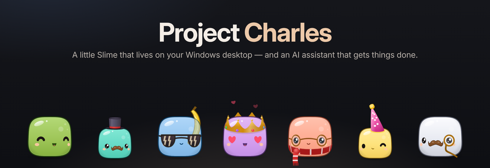
</p>

<p align="center">
  
  
  <a href="LICENSE"></a>
  
  
</p>

<p align="center">
  <a href="#install-and-update">Install</a> ·
  <a href="#kurulum-ve-güncelleme">Kurulum</a> ·
  <a href="#highlights--öne-çıkanlar">Highlights</a> ·
  <a href="#modules--modüller">Modules</a> ·
  <a href="#screenshots--ekran-görüntüleri">Screenshots</a> ·
  <a href="CHANGELOG.md">Changelog</a> ·
  <a href="docs/USER-GUIDE.md">User guide</a>
</p>

**Charles** is a desktop AI companion for Windows. A small *island* sits at the top of your
screen with your AI quota, the weather, your music and important mail. Click it and it opens
into a chat and project workspace. Living on top of it all is **Slime**, a jelly character
who reacts to what you and the AI are doing: he thinks while the AI thinks, codes on a tiny
laptop while it writes code, and gets dizzy if you shake him too hard.

**Charles**, Windows için bir masaüstü yapay zekâ arkadaşıdır. Ekranın üstündeki küçük
*adacıkta* yapay zekâ kotan, hava durumu, müziğin ve önemli e-postaların durur. Tıklayınca
sohbet ve proje çalışma alanına açılır. Hepsinin üstünde yaşayan **Slime**, senin ve yapay
zekânın yaptıklarına tepki veren jöle bir karakterdir: yapay zekâ düşünürken düşünür, kod
yazarken minik dizüstünde kod yazar, çok sallarsan da başı döner.

> Charles’s design is inspired by **Charles** from Sam Green’s *Epic Minequest* series on
> [YouTube](https://www.youtube.com/@SamGreen). · Charles’ın tasarımı Sam Green’in
> *Epic Minequest* serisindeki **Charles**’tan esinlenmiştir.

---

## v0.9.3 Beta · Convert & share / Dönüştür ve paylaş

<p align="center">
  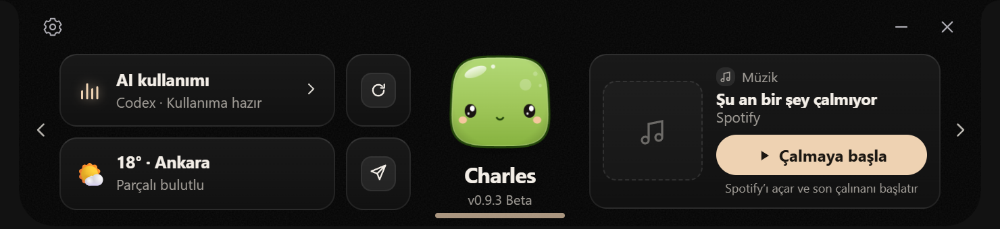
</p>

### Convert files on your desktop · Masaüstünde dosya dönüştür

Drop a file on the **circular arrow** beside Charles, choose an output format, then press
**Convert**. Images, audio, video, documents, data and archives stay on your computer.
Supported formats depend on the selected file and the installed tools; image and video
options include quality and output size. The result is saved beside the original.

Charles’ın yanındaki **dairesel ok** simgesine dosyanı bırak, hedef biçimi seç ve
**Dönüştür**’e bas. Görsel, ses, video, belge, veri ve arşiv işlemleri bilgisayarında yapılır.
Seçenekler dosya türüne ve kurulu araçlara göre gösterilir; görsel ve videolarda kalite ve
boyut seçebilirsin. Sonuç, orijinal dosyanın yanına kaydedilir.

<p align="center">
  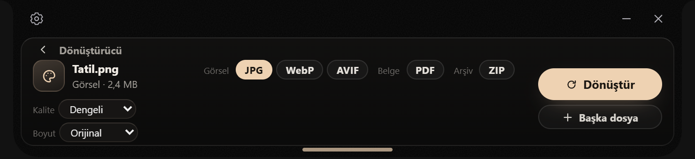
</p>

### All Android devices with Quick Share · Tüm Android cihazlarda Quick Share

Drop files on the **paper plane**, select a nearby device and send. Quick Share supports
two-way transfers between Android devices and computers on the same local
network. Charles remains discoverable while running when receiving is enabled, even with
the panel closed. An incoming request opens the accept/reject panel immediately.
Quick Share must be available and enabled on the Android device.

**Kâğıt uçak** simgesine dosya bırak, yakındaki cihazı seç ve gönder. Quick Share ile aynı
yerel ağdaki tüm Android cihazlar ve bilgisayarlar arasında iki yönlü aktarım
yapabilirsin. Alım açıkken Charles çalıştığı sürece bilgisayarın görünür kalır; paneli açık
tutman gerekmez. Gelen istek, kabul/ret panelini doğrudan açar.
Android cihazda Quick Share özelliğinin bulunması ve açık olması gerekir.

<p align="center">
  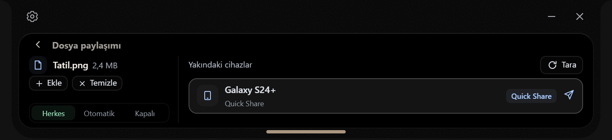
</p>

- **Everyone / Herkes:** asks before receiving / almadan önce onay ister.
- **Automatic / Otomatik:** receives without a prompt / onay beklemeden alır.
- **Off / Kapalı:** disables receiving and visibility / alımı ve görünürlüğü kapatır.

<p align="center">
  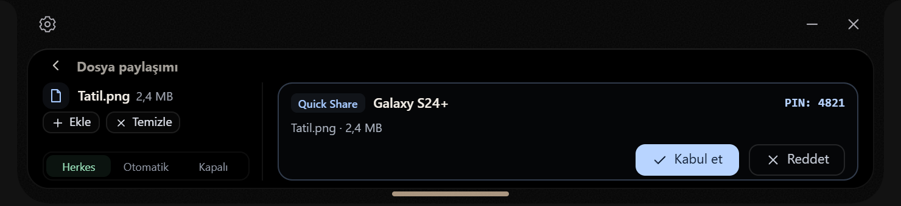
</p>

Received files go to Downloads; an existing file with the same name is preserved. QR is no
longer needed in this panel. Transfers have been tested successfully on Samsung and other Android brands.
Apple devices (iPhone, iPad and Mac) use the **LocalSend app** to share files with Charles
on the same local network. Native Apple AirDrop/AWDL is not supported on Windows.

Alınan dosyalar İndirilenler’e kaydedilir; aynı adlı eski dosyanın üzerine yazılmaz. Bu panelde
QR alanı kaldırıldı. Samsung ve farklı markalardaki Android telefonlarda aktarım başarıyla test edildi.
**Apple cihazlarda (iPhone, iPad ve Mac) LocalSend uygulaması ile dosya paylaşımı desteklenir.**
Apple cihazda LocalSend açık olmalı ve cihazlar aynı yerel ağa bağlı olmalıdır.
Windows’ta yerel Apple AirDrop/AWDL desteklenmez.

*Screenshots use sample file, device and status data. / Ekran görüntülerindeki dosya, cihaz
ve durum bilgileri tanıtım için örnektir.* [Sharing guide / Paylaşım rehberi](docs/SHARING.md)

## Highlights · Öne çıkanlar

### An assistant that does things

- **Island v2:** a thin strip at the top of the screen (a small notch with music controls while
  a song plays) opens into a card shelf (AI usage, weather, converter, file sharing, Charles, music) and grows
  down into the chat.
- **Converter:** drop files on the island to turn them into other formats: pictures, audio,
  video, Word/Markdown/PDF text, CSV/JSON, subtitles, ZIP. Offline, saved next to the original.
- **Your own AI accounts:** chat with **ChatGPT (Codex)**, **Claude**, **Gemini**, **Cursor** or
  **Abacus AI** and switch models from the message box. Pictures work with GPT, Claude and
  Gemini. Long chats keep their whole history, even on models without a thread of their own.
- **Projects:** chats in a project know each other. Charles sees the project’s instructions
  and what was said and decided in its other chats. Folders keep everything else tidy.
- **Project mode:** pick a folder and let the AI write code in it, with your approval first.
- **WhatsApp in Charles** *(experimental)*: link WhatsApp once with a QR code. New messages
  appear under the island, with quick replies and a reply box; nothing is sent until you press
  send. Typed or spoken *“send Mom ‘I’m on my way’ on WhatsApp”* works too.
- **Voice:** say **“Hey Charles”**. Gemini Live for real-time talk, local Whisper for dictation,
  and a microphone button that switches all listening off.
- **Mail and calendar:** Gmail, Google Calendar, Outlook or any POP3/IMAP mailbox. Important
  mail appears as a bubble under the island and opens in its own chat.
- **App window:** chats with projects and folders, an overview you arrange yourself (Spotify,
  reminders, calendar, mail, smart home, usage, system, notes, quick commands, **modules**),
  and a side panel for files, code and terminal output.
- **Modules:** add tools that open in their own window from a `.zip` (study planner, downloads,
  a game master…). Every ability goes through a permission you approve. Modules can use
  Charles’ own Slime, his reactions and accessories ([docs/MODULES.md](docs/MODULES.md)).
- **Little things:** copy formulas as LaTeX or Word equations, add instructions while the AI is
  still working, reminders and focus timers, weather, screen capture, Home Assistant, and
  in-app updates from GitHub.

### A character with personality

- More than 20 expressions and work animations: in love, dizzy, sleeping, researching with a
  magnifier, coding, drawing, getting an idea 💡 and more.
- **Slime studio:** seven colours, a moustache, and hats, glasses and other accessories to mix
  and match. Seasonal hats come on their own.
- **Desktop pet:** drag Slime onto your desktop, throw him and watch him bounce like jelly.
- Interface in **English, Türkçe, Deutsch, Français, Español and 中文**.

### İş yapan bir asistan

- **Ada v2:** ekranın üstündeki ince şerit (şarkı çalarken müzik tuşlu küçük notch), kart rafına
  (AI kullanımı, hava, Dönüştürücü, dosya paylaşımı, Charles, müzik) açılır ve aşağı uzayıp sohbete dönüşür.
- **Dönüştürücü:** dosyaları adaya bırak, başka biçime çevir: görsel, ses, video, Word/Markdown/PDF
  metni, CSV/JSON, altyazı, ZIP. İnternetsiz, sonuç orijinalin yanına kaydedilir.
- **Kendi yapay zekâ hesapların:** **ChatGPT (Codex)**, **Claude**, **Gemini**, **Cursor** ya da
  **Abacus AI** ile sohbet et, modeli mesaj kutusundan değiştir. Görseller GPT, Claude ve
  Gemini ile çalışır. Uzun sohbetler geçmişin tamamını korur.
- **Projeler:** bir projedeki sohbetler birbirini bilir; Charles projenin talimatlarını ve diğer
  sohbetlerde konuşulup kararlaştırılanları görür. Klasörler de geri kalanını düzenli tutar.
- **Proje modu:** bir klasör seç, yapay zekâ önce onayını alarak orada kod yazsın.
- **WhatsApp Charles’ta** *(deneysel)*: WhatsApp’ı bir kez QR kodla bağla. Yeni mesajlar
  adacığın altında, hızlı yanıtlar ve yanıt kutusuyla görünür; sen gönder’e basmadan hiçbir şey
  gitmez. Yazılı ya da sesli *“WhatsApp’tan anneme ‘yoldayım’ mesajını at”* da çalışır.
- **Ses:** **“Hey Charles”** de. Gerçek zamanlı konuşma için Gemini Live, dikte için yerel
  Whisper ve tüm dinlemeyi kapatan mikrofon tuşu.
- **E-posta ve takvim:** Gmail, Google Takvim, Outlook ya da herhangi bir POP3/IMAP kutusu.
  Önemli e-postalar adacığın altında balon olarak görünür ve kendi sohbetinde açılır.
- **Uygulama penceresi:** proje ve klasörlü sohbetler, kendin düzenlediğin genel bakış
  (Spotify, hatırlatıcılar, takvim, e-posta, akıllı ev, kullanım, sistem, notlar, hızlı
  komutlar, **modüller**) ve dosya, kod ve terminal çıktısı için yan panel.
- **Modüller:** kendi penceresinde açılan araçları `.zip` ile ekle (ders planlayıcı, indirme,
  oyun yöneticisi…). Her yetki senin onayladığın bir izinle gelir. Modüller Charles’ın Slime’ını,
  tepkilerini ve aksesuarlarını kullanabilir.
- **Küçük şeyler:** formülleri LaTeX ya da Word denklemi olarak kopyalama, yapay zekâ çalışırken
  ek talimat, hatırlatıcılar ve odak sayacı, hava durumu, ekran yakalama, Home Assistant ve
  GitHub’dan uygulama içi güncelleme.

### Kişiliği olan bir karakter

- 20’den fazla ifade ve çalışma animasyonu: âşık, başı dönen, uyuyan, büyüteçle araştıran, kod
  yazan, çizen, fikir bulan 💡 ve daha fazlası.
- **Slime stüdyosu:** yedi renk, bıyık ve birlikte takılabilen şapka, gözlük ve aksesuarlar.
  Mevsimlik şapkalar kendiliğinden gelir.
- **Masaüstü Slime:** Slime’ı masaüstüne sürükle, fırlat, jöle gibi sekmesini izle.
- Arayüz **English, Türkçe, Deutsch, Français, Español ve 中文**.

## Modules · Modüller

<p align="center">
  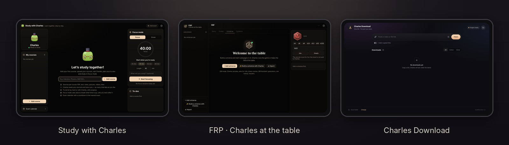
</p>

Modules add whole new tools to Charles, each in its own window: **Study with Charles** (courses,
sources, a tutor that reads them, focus timer, exam countdown), **FRP** (Charles runs your
tabletop game or helps the GM) and **Charles Download** (videos, audio or just the part you
want). Install them from a `.zip` in **Settings → Modules**; the open ones are one click away on
the **Modules** card of the overview.

**Get the official modules:** [**Releases → Modules**](https://github.com/ardadgnyt/ProjectCharles/releases#release-Modules)

**Build your own:** anyone can make a module. A module is a small web page with a
`manifest.json`; through Charles it can ask the user’s AI (with pictures), create images, speak,
keep its own files, show notifications, use Charles’ download engine, and draw Slime with his
accessories, reactions and cursor tracking — every ability behind a permission the user
approves. See [docs/MODULES.md](docs/MODULES.md).

Modüller Charles’a kendi penceresinde açılan yeni araçlar ekler: **Study with Charles** (dersler,
kaynaklar, onları okuyan bir eğitmen, odak sayacı, sınav geri sayımı), **FRP** (Charles masaüstü
rol yapma oyununu yönetir ya da GM’e yardım eder) ve **Charles Download** (video, ses ya da
yalnızca istediğin bölüm). **Ayarlar → Modüller**’den `.zip` ile yüklenir; açılanlar genel
bakıştaki **Modüller** kartından tek tıkla açılır.

**Resmî modülleri indir:** [**Releases → Modules**](https://github.com/ardadgnyt/ProjectCharles/releases#release-Modules)

**Kendi modülünü yap:** herkes modül geliştirebilir. Modül, `manifest.json` dosyası olan küçük bir
web sayfasıdır; Charles üzerinden kullanıcının yapay zekâsına (görsellerle) soru sorabilir,
görsel oluşturabilir, sesli okuyabilir, kendi dosyalarını tutabilir, bildirim gösterebilir,
Charles’ın indirme altyapısını kullanabilir ve Slime’ı aksesuarları, tepkileri ve imleç
takibiyle çizebilir. Her yetki, kullanıcının onayladığı bir izinle gelir.
Ayrıntılar: [docs/MODULES.md](docs/MODULES.md).

## Screenshots · Ekran görüntüleri

<p align="center">
  
</p>

<p align="center">
  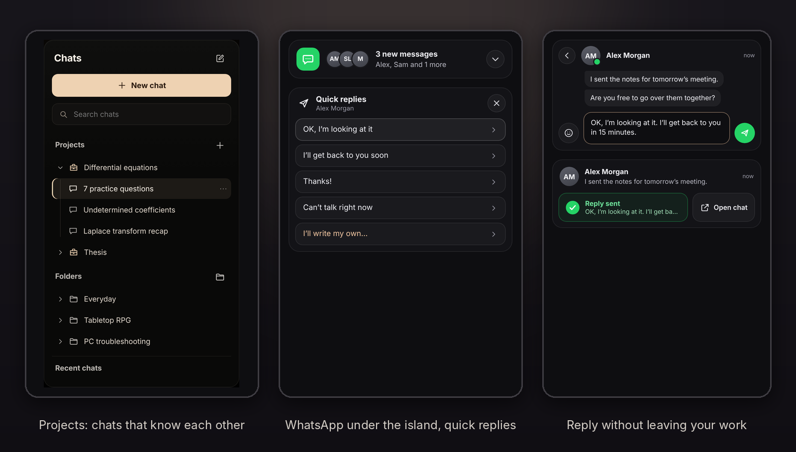
</p>

<p align="center">
  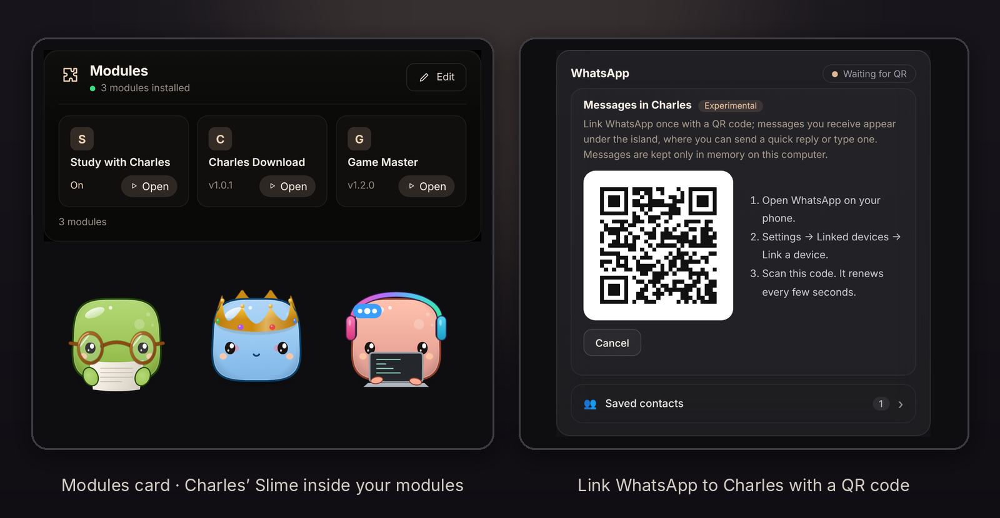
</p>

<p align="center">
  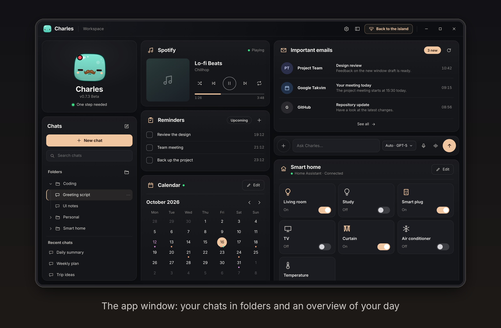
</p>

<p align="center">
  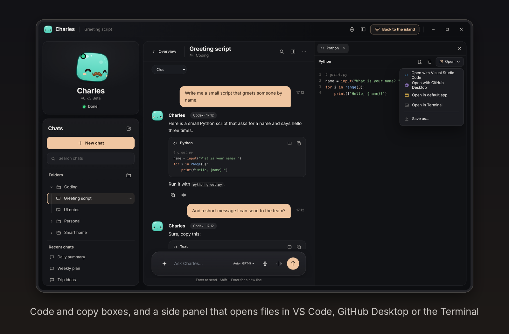
</p>

<p align="center">
  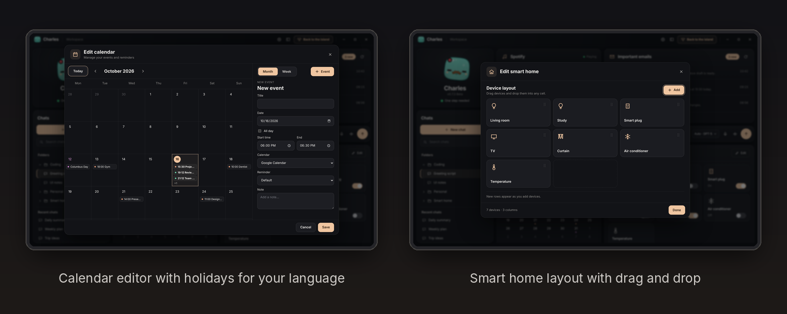
</p>

<p align="center">
  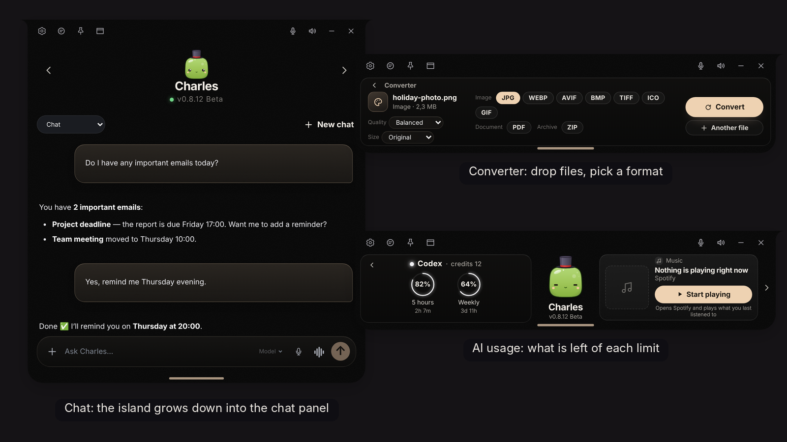
</p>

<p align="center">
  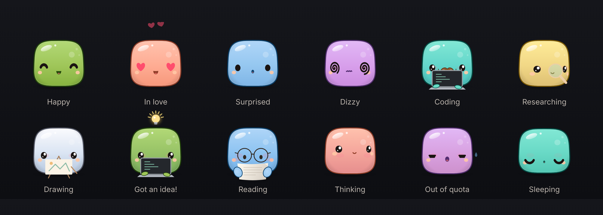
</p>

## Install and update

**Download:** the latest **ProjectCharles-vX.X.X-Beta-Setup.zip** from
[**Releases**](../../releases). Windows 10 or 11 (64-bit), no administrator rights needed.
Already using Charles? **Settings → General → Updates** updates it in place — the in-app
updater works reliably from **v0.8.2** on. · Charles zaten kurulu mu? **Ayarlar → Genel →
Güncellemeler** yerinde günceller; uygulama içi güncelleme **v0.8.2**’den itibaren kararlı
çalışır.

<table>
<tr><td width="50%" valign="top">

#### 🇬🇧 English

1. Download **ProjectCharles-vX.X.X-Beta-Setup.zip** and extract the whole folder.
2. Double-click **Install.cmd** and press Enter.

Requires Windows 10 or 11 (64-bit). No administrator rights needed. If SmartScreen warns you,
choose **More info → Run anyway**.

**Updating from an older version:** use the update option inside Charles — no need to deal
with GitHub — or simply install vX.X.X with the steps above. The in-app update works reliably
from v0.8.2 on; on older versions use the setup once. Your chats, settings and keys stay in
`%APPDATA%\Charles`.

</td><td width="50%" valign="top">

#### 🇹🇷 Türkçe <a id="kurulum-ve-güncelleme"></a>

1. **ProjectCharles-vX.X.X-Beta-Setup.zip** dosyasını indirin ve içindeki tüm klasörü dışa aktarın.
2. **Install.cmd** dosyasına çift tıklayın ve Enter tuşuna basın.

Windows 10 veya 11 (64-bit) gerektirir. Yönetici izni gerekmez. Windows SmartScreen bir
uyarı verirse **Daha fazla bilgi → Yine de çalıştır** seçeneğini belirleyin.

**Daha eski bir sürümden güncelleme:** Charles içindeki güncelleme seçeneğiyle GitHub ile
uğraşmadan güncelleyebilir ya da vX.X.X sürümünü yukarıdaki adımlarla kurabilirsiniz.
Uygulama içi güncelleme v0.8.2’den itibaren kararlı çalışır; daha eski sürümlerde bir kez
kurulumu kullanın.
Sohbetleriniz, ayarlarınız ve anahtarlarınız `%APPDATA%\Charles` dizininde korunur.

</td></tr>
<tr><td valign="top">

#### 🇩🇪 Deutsch

1. Lade **ProjectCharles-vX.X.X-Beta-Setup.zip** herunter und entpacke den gesamten Ordner.
2. Doppelklicke auf **Install.cmd** und drücke die Eingabetaste (Enter).

Erfordert Windows 10 oder 11 (64-Bit). Es sind keine Administratorrechte erforderlich. Falls
eine SmartScreen-Warnung erscheint, wähle **Weitere Informationen → Trotzdem ausführen**.

**Aktualisierung von einer älteren Version:** Du kannst das Update direkt über die
entsprechende Option in Charles durchführen – ohne den Umweg über GitHub – oder einfach
Version vX.X.X mit den Schritten oben installieren. Das In-App-Update funktioniert ab v0.8.2
zuverlässig; bei älteren Versionen nutze einmal das Setup. Deine Chats, Einstellungen und Schlüssel
bleiben in `%APPDATA%\Charles` erhalten.

</td><td valign="top">

#### 🇫🇷 Français

1. Téléchargez **ProjectCharles-vX.X.X-Beta-Setup.zip** et extrayez le contenu du dossier.
2. Double-cliquez sur **Install.cmd** et appuyez sur la touche Entrée.

Nécessite Windows 10 ou 11 (64 bits). Aucun droit d’administrateur n’est requis. Si
SmartScreen affiche un avertissement, sélectionnez **Informations complémentaires → Exécuter
quand même**.

**Mise à jour depuis une version antérieure :** utilisez l’option de mise à jour dans
Charles — sans passer par GitHub — ou installez simplement la version vX.X.X avec les étapes
ci-dessus. La mise à jour intégrée fonctionne de façon fiable depuis la v0.8.2 ; sur les
versions plus anciennes, utilisez une fois l’installateur. Vos discussions, paramètres et clés sont conservés dans `%APPDATA%\Charles`.

</td></tr>
<tr><td valign="top">

#### 🇪🇸 Español

1. Descarga **ProjectCharles-vX.X.X-Beta-Setup.zip** y extrae todo el contenido de la carpeta.
2. Haz doble clic en **Install.cmd** y pulsa Enter.

Requiere Windows 10 u 11 (64 bits). No se necesitan privilegios de administrador. Si aparece
una advertencia de SmartScreen, selecciona **Más información → Ejecutar de todas formas**.

**Actualización desde una versión anterior:** usa la opción de actualización dentro de
Charles —sin recurrir a GitHub— o instala la versión vX.X.X con los pasos de arriba. La
actualización integrada funciona de forma estable desde la v0.8.2; en versiones anteriores usa
el instalador una vez. Tus
chats, configuraciones y claves se conservan en `%APPDATA%\Charles`.

</td><td valign="top">

#### 🇨🇳 简体中文

1. 下载 **ProjectCharles-vX.X.X-Beta-Setup.zip** 并解压整个文件夹。
2. 双击 **Install.cmd**，然后按回车键 (Enter)。

需使用 Windows 10 或 11（64 位）系统。无需管理员权限。如果出现 SmartScreen 提示，请选择
“更多信息” (More info) → “仍要运行” (Run anyway)。

**从旧版本更新：** 您可以通过 Charles 软件内的更新选项直接更新（无需访问 GitHub），或者按照上面的
步骤安装 vX.X.X 版本。应用内更新自 v0.8.2 起可稳定使用；更早的版本请先用安装包安装一次。您的聊天记录、设置和密钥均保存在 `%APPDATA%\Charles` 目录下，不会丢失。

</td></tr>
</table>

The installer asks for its language first (English by default), copies Charles to
`C:\ProjectCharles vX.X.X Beta` (you can pick another folder), creates Desktop and Start menu
shortcuts and starts Charles. Then sign in with your AI account in **Settings → AI models**.
· Kurulum önce dilini sorar, Charles’ı `C:\ProjectCharles vX.X.X Beta` klasörüne kopyalar
(başka bir klasör seçebilirsin), Masaüstü ve Başlat kısayollarını oluşturup Charles’ı açar.
Sonra **Ayarlar → Yapay zekâ modelleri**’nden hesabınla giriş yap.

| File · Dosya | What it does · Ne yapar |
| --- | --- |
| `setup/Install.cmd` | Installs Charles · Charles’ı kurar |
| `setup/install.ps1` | The installer itself · Kurulumun kendisi |
| `setup/Create-Desktop-Shortcut.vbs` | Desktop shortcut for this folder · Bu klasör için masaüstü kısayolu |
| `setup/Reset-Charles.cmd` | Backs up and resets settings and chats (asks first) · Ayarları ve sohbetleri yedekleyip sıfırlar (önce sorar) |
| `Start-Charles.cmd` | Starts Charles from its folder · Charles’ı klasöründen başlatır |

## Running from source · Kaynaktan çalıştırma

The repository holds source code only; `node_modules/`, `dist/`, the speech models and the
helper tools are created or downloaded on your machine. You need [Node.js](https://nodejs.org)
22 or newer. · Depo yalnızca kaynak kodu içerir; `node_modules/`, `dist/`, ses modelleri ve
yardımcı araçlar bilgisayarında oluşturulur ya da indirilir. Node.js 22 veya üstü gerekir.

```cmd
git clone https://github.com/HzPederPan/ProjectCharles.git
cd ProjectCharles
npm ci
npm run setup
npm run build
npm start
```

| Command · Komut | Purpose · Amaç |
| --- | --- |
| `npm run setup:voice` | Optional: whisper.cpp and the speech model (~500 MB) · İsteğe bağlı: whisper.cpp ve ses modeli |
| `npm test` | Automated tests · Otomatik testler |
| `npm run dev` | Build the interface and start Electron · Arayüzü derleyip Electron’u başlatır |
| `python scripts/package.py <folder> <out.zip>` | `Charles.zip` for the installer · Kurulum için `Charles.zip` |
| `npm run release:pack` | `charles-update-<version>.zip` + `.sha256` for in-place updates · Uygulama içi güncelleme paketi |

The Gemini (Antigravity) and Cursor sign-in helpers come with the release package. Abacus AI
uses its own `abacusai` command line tool
([setup page](https://abacus.ai/help/abacusai-desktop/cli-installation)). · Gemini ve Cursor
giriş araçları kurulum paketiyle gelir; Abacus AI kendi `abacusai` aracını kullanır.

## Your data and privacy · Verilerin ve gizlilik

- Chats, memory, settings and **all keys and account connections** live in
  **`%APPDATA%\Charles`**, never in the app folder; keys are encrypted with Windows (DPAPI). ·
  Sohbetler, hafıza, ayarlar ve **tüm anahtarlar ve hesap bağlantıları** uygulama klasöründe
  değil **`%APPDATA%\Charles`** içinde durur; anahtarlar Windows (DPAPI) ile şifrelenir.
- Updates and new installs keep your data. **Settings → Account** opens this folder and can
  remove connections or reset everything (it asks first and keeps a backup). · Güncellemeler ve
  yeni kurulumlar verilerini korur. **Ayarlar → Hesap** bu klasörü açar; bağlantıları kaldırıp
  her şeyi sıfırlayabilir (önce sorar ve yedek alır).
- Mail, calendar and Drive connections are **read-only**; incoming content never runs
  commands. · E-posta, takvim ve Drive bağlantıları **salt okunurdur**; gelen içerik komut
  çalıştıramaz.
- **WhatsApp** messages stay in memory only. The open-source gateway is downloaded only when you
  turn the feature on, checked against its SHA-256 and runs on this computer only. ·
  **WhatsApp** mesajları yalnızca bellekte tutulur. Açık kaynaklı köprü yalnızca özelliği açınca
  indirilir, SHA-256 ile doğrulanır ve yalnızca bu bilgisayarda çalışır.
- The microphone button turns off Hey Charles, dictation and voice chat. Your messages go only
  to the AI provider you choose. · Mikrofon tuşu Hey Charles’ı, dikteyi ve sesli sohbeti kapatır.
  Mesajların yalnızca seçtiğin yapay zekâ sağlayıcısına gider.

## Project layout · Proje yapısı

```text
ProjectCharles/
├── Start-Charles.cmd     start Charles from this folder · Charles’ı bu klasörden başlatır
├── setup/                installer, shortcut, reset · kurulum, kısayol, sıfırlama
├── app/                  Electron main process: AI, plugins, modules, voice · ana süreç
├── src/                  interface (TypeScript) → dist/renderer.js · arayüz
│   ├── vendor/slime/     the Slime character · Slime karakteri
│   └── module-kit/       Slime for module windows · modül pencereleri için Slime
├── public/               HTML, CSS, sounds, icons · HTML, CSS, sesler, simgeler
├── scripts/              build, packaging, voice setup · derleme, paketleme
├── test/                 automated tests · otomatik testler
└── docs/                 guides and README images · rehberler ve görseller
```

## Documentation · Belgeler

| Document · Belge | Contents · İçerik |
| --- | --- |
| [CHANGELOG.md](CHANGELOG.md) | What changed in every version (Turkish) · Her sürümde değişenler |
| [DEVELOPMENT.md](DEVELOPMENT.md) | Code tour, data files, build and test (Turkish) · Kod turu, derleme, test |
| [docs/USER-GUIDE.md](docs/USER-GUIDE.md) | Chat, project mode, voice, Slime, settings, shortcuts · Kullanım rehberi |
| [docs/PLUGINS-SETUP.md](docs/PLUGINS-SETUP.md) | Google, Microsoft, mail, Home Assistant · Eklenti kurulumu |
| [docs/ARCHITECTURE.md](docs/ARCHITECTURE.md) | How the parts fit together · Mimari |
| [docs/MODULES.md](docs/MODULES.md) | Writing modules: package, permissions, API, Slime kit · Modül yazma |
| [docs/UPDATES.md](docs/UPDATES.md) | In-place updates from GitHub Releases · Uygulama içi güncellemeler |

## Credits · Teşekkürler

- Charles’s design is inspired by **Charles** from the *Epic Minequest* series on
  [Sam Green’s YouTube channel](https://www.youtube.com/@SamGreen). Project Charles is a
  fan-inspired, independent project, not affiliated with or endorsed by Sam Green. · Project
  Charles hayran esinli, bağımsız bir projedir; Sam Green ile bağlantılı değildir.
- Quick Share protocol adaptation: [MultiDrop](https://github.com/digitaldanis/multidrop), GPL-3.0-or-later.

## License · Lisans

Copyright © 2026 **HzPederPan**.

The source code is licensed under **GNU GPL v3 or later**. You may use, modify
and redistribute it under that license, including commercially. Distributed
builds include the corresponding Charles source and build scripts. Third-party
components retain their notices. Artwork and names are described separately in
[LICENSE-ASSETS.md](LICENSE-ASSETS.md).

Kaynak kod **GNU GPL v3 veya sonraki sürümler** ile lisanslanmıştır. Lisans
koşulları altında kullanım, değiştirme ve ticari kullanım dahil yeniden dağıtım
serbesttir. Bkz. [LICENSE](LICENSE) ve [THIRD-PARTY-NOTICES.md](THIRD-PARTY-NOTICES.md).

Charles is an independent project. It is not affiliated with OpenAI, Anthropic, Google,
Cursor, Abacus AI or WhatsApp. · Charles bağımsız bir projedir; bu şirketlerle bağlantılı
değildir.
