<p align="center">
  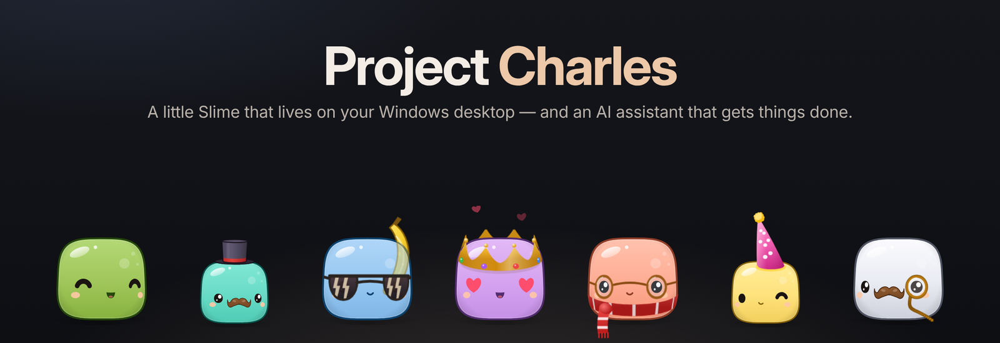
</p>

<p align="center">
  
  
  <a href="LICENSE"></a>
  
  
</p>

<p align="center">
  <a href="#install-and-update">Install</a> ·
  <a href="#highlights">Highlights</a> ·
  <a href="#modules">Modules</a> ·
  <a href="#screenshots">Screenshots</a> ·
  <a href="CHANGELOG.md">Changelog</a> ·
  <a href="docs/USER-GUIDE.md">User guide</a>
</p>

**Charles** is a desktop AI companion for Windows. A small *island* sits at the top of your
screen with your AI quota, the weather, your music and important mail. Click it and it opens
into a chat and project workspace. Living on top of it all is **Slime**, a jelly character
who reacts to what you and the AI are doing: he thinks while the AI thinks, codes on a tiny
laptop while it writes code, and gets dizzy if you shake him too hard.

> Charles’s design is inspired by **Charles** from Sam Green’s *Epic Minequest* series on
> [YouTube](https://www.youtube.com/@SamGreen).

---

## What’s new

| Version | What’s new |
| --- | --- |
| **v0.9.23** | Readable links in the chat · the app window uses the island's dark message style, with your messages on the right · attachments in the app window match the island · sent pictures line up on the right · no status line under Charles in the app window |
| **v0.9.22** | Push to talk on Right + Up, and the key can be changed again · attachments on cards inside the message box · one black theme for Settings and Review changes · no shadow under Charles on the desktop · long chats open without freezing |
| **v0.9.21** | Settings open every time in the app window · dropping a shelf file on a name that already exists no longer freezes the mouse · Quick Share asks in the app window too |
| **v0.9.20** | One small helper instead of several PowerShell processes · mail dates no longer open Outlook by themselves · shelf files drag like files on the desktop · a Small size for the island |
| **v0.9.19** | Charles goes back by himself after reading · content goes with one message · edit a message in its own bubble · the push-to-talk bubble sits under the island · a more reliable target frame that leaves the desktop alone · less memory and CPU |
| **v0.9.18** | System monitor for CPU, GPU and RAM · push to talk in any app · drop Charles on a page or document to ask about it · drag the character out of the panel · right-click menu for text · notifications stay visible with the app window open · a summary after each update |
| **v0.9.17** | Quick Share: a stale phone address is looked up again before giving up, with a clear message if the phone stays closed |
| **v0.9.16** | PowerPoint in the chat and the converter (.pptx, .ppt → PDF, Word, slide pictures, text) · File shelf: Ctrl+V adds a screenshot, previews on every row, a drag card with the file's name · Scrolling while an answer is written · Clearer Quick Share start errors, LocalSend works on its own · Fixes for the limit animation, the finished state and the taskbar |
| **v0.9.15** | File shelf: keep copies of files on the island, drag them out as real files, Ctrl+V adds a screenshot · Pictures in a sent message open at full size · Antigravity quota checks no longer flash a terminal window |
| **v0.9.14** | Island redesign: a big voice chat card (bars that move with the voice), the message box with dictation, a new Spotify card and the song on the closed island · **Tools**: color picker, timer (focus with breaks, countdown, stopwatch), reminders, calendar, emails, usage summary and smart home, plus module shortcuts · faster, HDR-correct screenshots and color picking · design polish |
| **v0.9.13** | Redesigned island home: Charles with an inline message box (mic, voice call), a new Spotify card and three expanding cards (Files · AI usage · Weather with hourly forecast) · quiet WhatsApp catch-up, muted/archived chats stay silent |
| **v0.9.12** | Modules can save and open files (`files.save`, `files.pick`) through Windows’ own Save / Open window |
| **v0.9.11** | Long chats can be continued after a restart · Charles sleeps when you are away |
| **v0.9.10** | Smoother Slime (no waving in his sleep, no doubled cheeks) · durations in your language · tables with formulas and file citations render properly · the chat keeps its place |
| **v0.9.9** | Mail can’t steer Charles (prompt-injection guard) · app window fixes · Download tools included |
| **v0.9.8** | No third hand · props change one at a time · movable app window · EVREN setup · Claude models by version |
| **v0.9.7** | Quick Share network permission fixed · menu arrows point the right way |
| **v0.9.6** | Effort levels · EVREN account · Quick Share visible without opening the panel |

Details: [CHANGELOG](CHANGELOG.md) · [File sharing](docs/SHARING.md)

### The island

A big **voice chat** card (tap and talk; its bars follow your voice and Charles’), a message box
with dictation, Charles in the middle, the Spotify card, and four cards that open a panel below
them: **Files**, **AI usage**, **Weather** and **Tools**. While music plays, the closed island
shows the cover, the song and the artist.

<p align="center">
  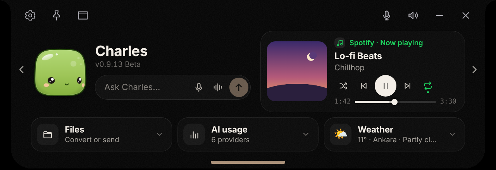
</p>

### Tools

The **Tools** card opens eight tools and your installed modules. Reminders, Calendar, Emails and
Smart home are the same cards as in the app window; Usage summary is the weekly summary from
Settings.

| Tool | What it does |
| --- | --- |
| **Color picker** | Pick a color anywhere on the screen with a magnifier (correct on HDR screens too), adjust it, copy it as HEX · RGB · HSL; four shades and your recent colors |
| **Timer** | Focus sessions with a task name, a break you choose when the focus ends, countdown and stopwatch; it keeps running on the closed island and can mute notifications |
| **Reminders** | Upcoming reminders, tick them off, add a new one; Charles can also add them by voice |
| **Calendar** | The month with Google / Outlook events, reminders and holidays; the day’s list; Edit opens the full editor |
| **Emails** | Important emails (or the newest ones); a click lets Charles explain the email in the chat |
| **Usage summary** | This week or last week: computer time, active use, Charles’ work, sessions, files, commands and your most used apps |
| **Smart home** | Your Home Assistant lights, plugs, sensors and scenes; switch them on the tile |
| **System monitor** | Live CPU, GPU and RAM charts with Current, Average and Peak values |

<p align="center">
  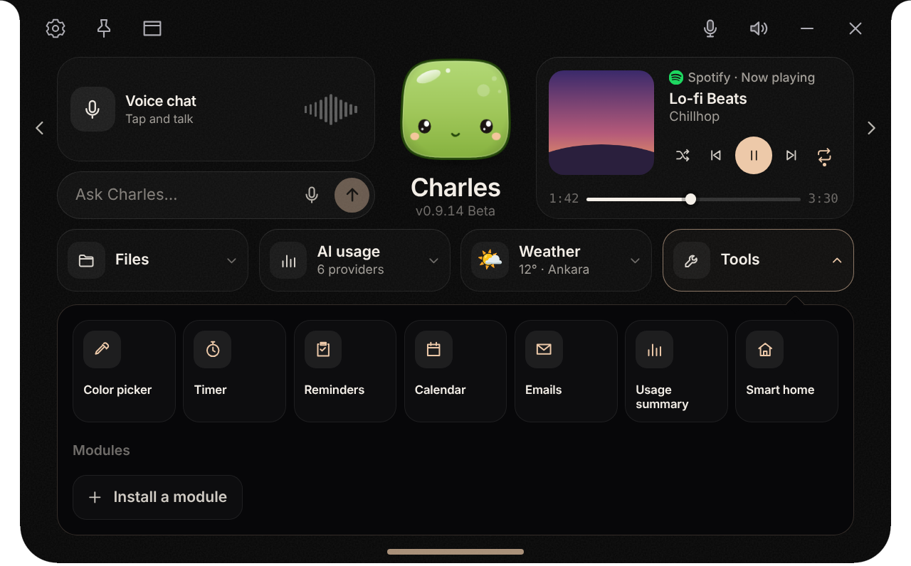
</p>

<p align="center">
  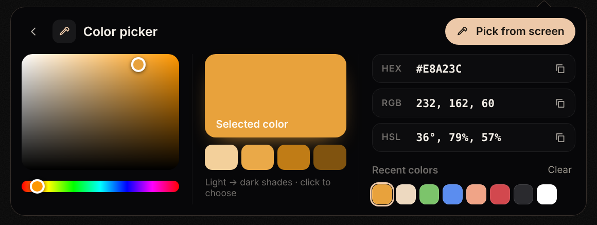
  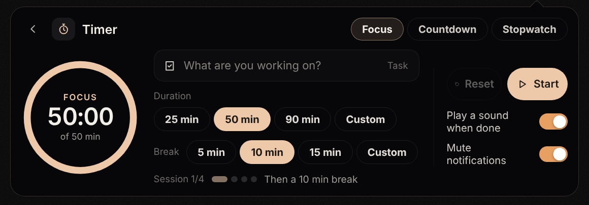
</p>
<p align="center">
  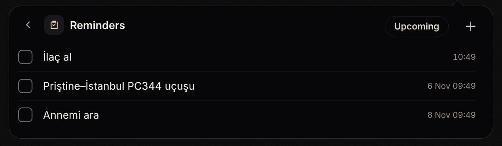
  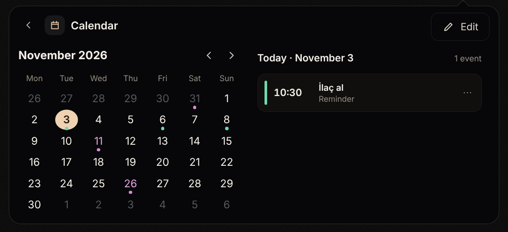
</p>
<p align="center">
  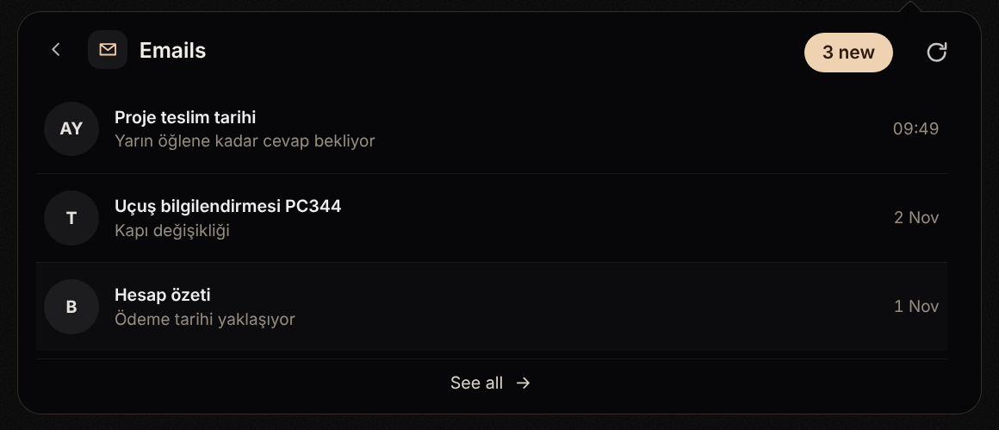
  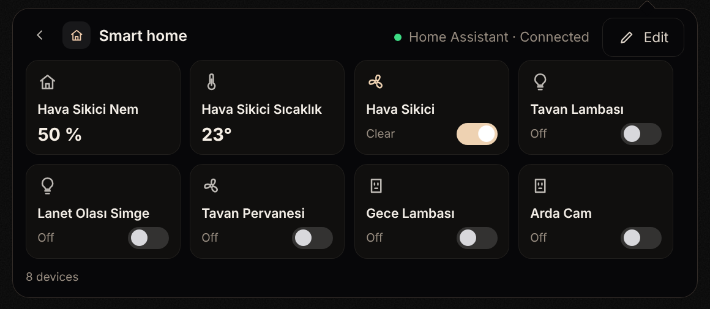
</p>
<p align="center">
  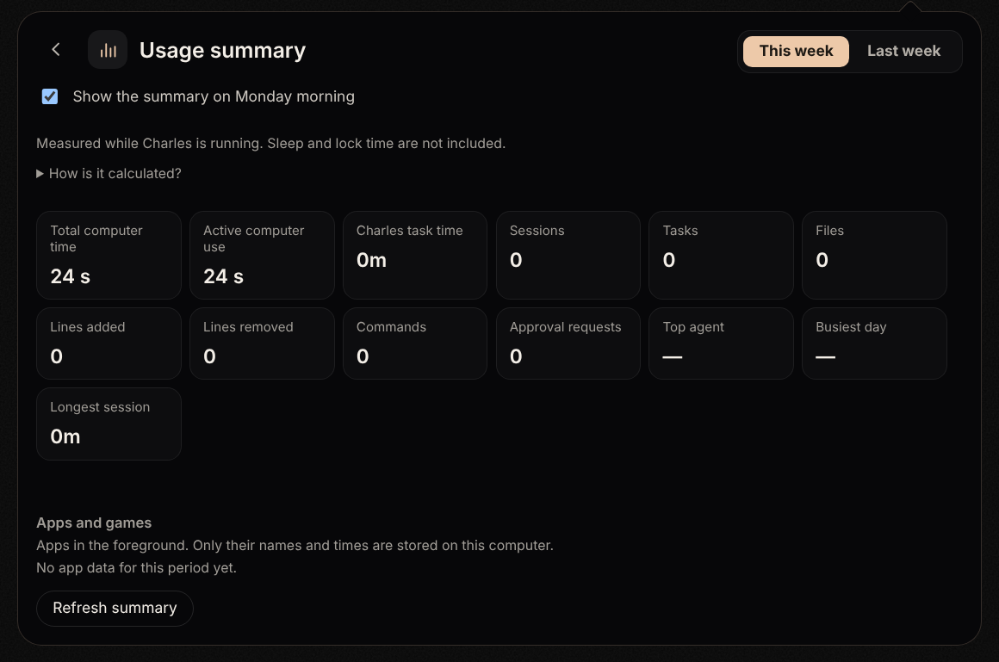
</p>

### System monitor

Open **Tools → System monitor** to watch CPU, GPU and RAM side by side.

- **Current, Average, Peak:** pick what the big numbers show. The chart keeps running and marks the average or the peak.
- **1 min, 5 min, 1 hr:** the numbers and the chart always use the same range. A range that is not full yet says how long was really measured.
- **Pause and reset:** stop measuring for a moment, or clear the history.
- **Several GPUs:** a list lets you pick which one to follow.

Charles measures once a second while the monitor is on screen and every 5 seconds behind it, so
history is already there when you open it; **Measure in the background** turns that off. The last
hour stays in memory. Nothing is written to disk or sent anywhere, and time the computer slept
shows as a gap in the line.

Values come from Windows performance counters, so no driver or extra tool is needed. GPU load is
the busiest engine, as in Task Manager. GPU temperature and power appear when Windows reports them,
and power is a percentage rather than watts. CPU temperature has no reliable source and shows
**No data**. Tested on one NVIDIA GPU; several GPUs and other vendors have not been tested.

<p align="center">
  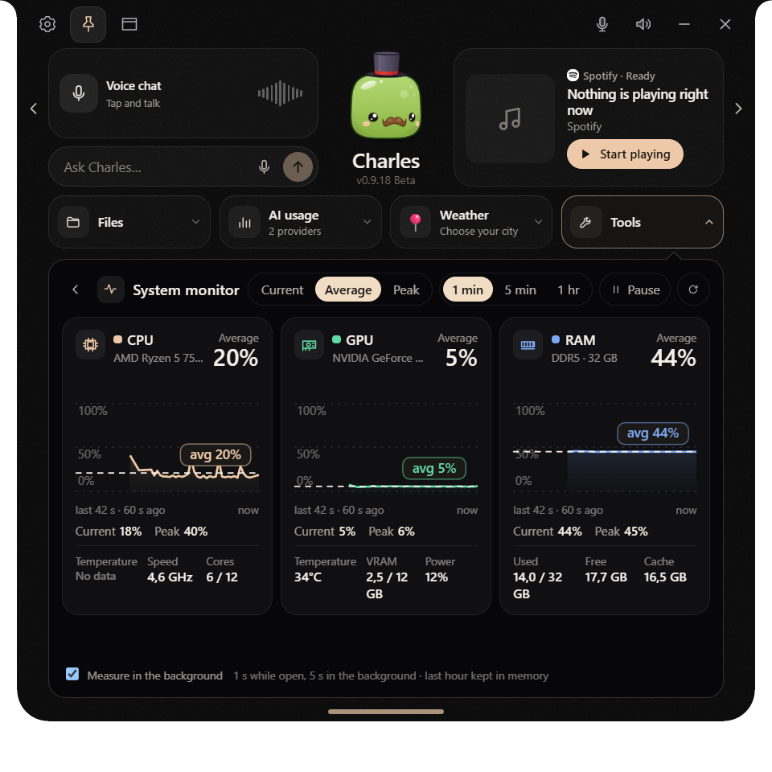
</p>

### Ask about what is on your screen

Hold Charles over a web page, a document or an email for a moment. A frame shows what he would
read. Let go, and only that one thing is read. A card above the message box then shows the title,
the app and how much was read, with **Summarize**, **Key points** and **What I need to do**; you
can also type your own question. Moving Charles without stopping is just a move, and **Esc** cancels.

Dropping him sends nothing to an AI. Content goes out only when you press a button or send a
question, and the card names the AI it goes to. While the card is open the content goes with each
question; **×** removes it. Text from a page or a file is treated as data, so instructions hidden
in it are not followed, and such a turn runs without tools.

No browser extension is needed. Charles uses the Windows accessibility interface, so he reads what
an app shares:

| Where | What is read |
| --- | --- |
| Chrome and Edge pages | The loaded text of the page in the active tab (no other tabs); parts that load while scrolling are left out |
| PDFs opened from this computer in Chrome or Edge | The whole file |
| Word and PowerPoint (`.docx`, `.pptx`, `.ppt`) | The saved file, with slide numbers and notes; unsaved changes are not included, and the card says so |
| Notepad and similar editors | The text in the window |
| Adobe Acrobat, and apps that share no text | A picture of that window, marked as the visible part only |
| Web mail | Read as a page |

Other browsers and desktop mail apps depend on what they share and have not been tested. Password
managers and windows with a password field in focus are not read.

<p align="center">
  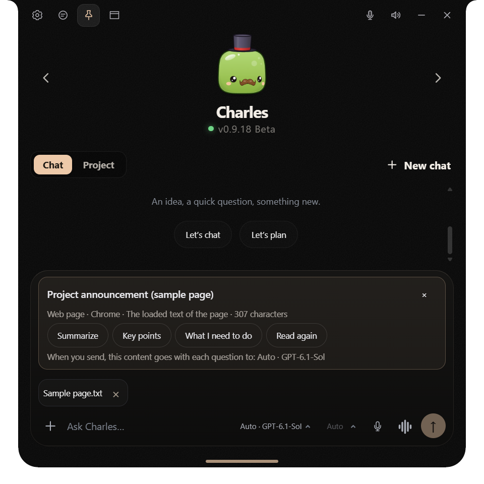
</p>

### Push to talk

Type with your voice in any app. Turn it on in **Settings → Shortcuts → Push to talk**.

- **Hold Right Arrow + Up Arrow together, speak, let go:** your words are typed at the cursor. Either
  key can go first.
- **Press the pair twice quickly:** hands-free recording; press it again to finish.
- **Esc:** cancels the recording or the text that is on its way.

You can choose another key or combination in the same place: one key, two keys pressed together, or
a combination with Ctrl, Alt, Shift or Win. While the feature is on, either arrow pressed alone still
does its normal job, a moment later. It is off by default and steps aside for full-screen apps such
as games.

Speech is turned into text by the local Whisper model. Audio stays on your computer and no
recording is kept. The clipboard is not used and Enter is never pressed. Password fields and apps
running as administrator are not typed into, and if the focus moves while you speak, the text waits
in a small card so you can copy it or insert it. The status bubble appears right under the island,
where notifications appear, and takes neither the keyboard nor the focus.

### Convert files on your desktop

Open **Files → Convert** (or drag a file onto the **Files** card: its Convert / Send tiles open
by themselves), choose an output format, then press **Convert**. Images, audio, video, documents, presentations, data and archives stay on your computer.
Supported formats depend on the selected file and the installed tools; image and video
options include quality and output size. The result is saved beside the original.

<p align="center">
  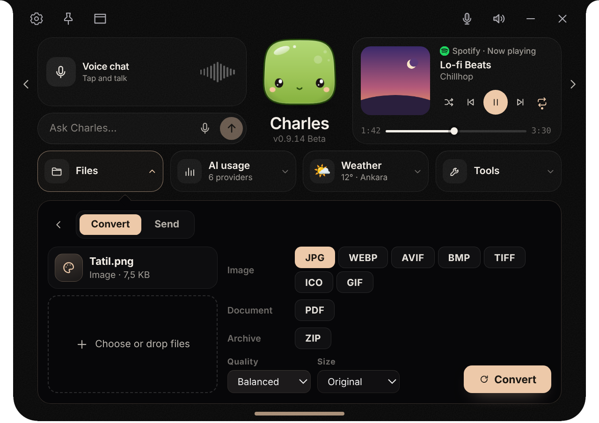
</p>

### File shelf

Keep files on the island until you need them. Open **Files → File shelf**, then:

- **Add files:** drag them onto the shelf. Charles keeps its own copy, so the original can move or disappear.
- **Paste a screenshot:** with the shelf on screen, press **Ctrl+V**. A picture on the clipboard is saved as a PNG with a preview.
- **Take them out:** drag a row to a folder or another program. It arrives as a real file, and the file’s picture and name follow the pointer on a transparent background.

Files stay on the shelf after a restart, until you remove them.

<p align="center">
  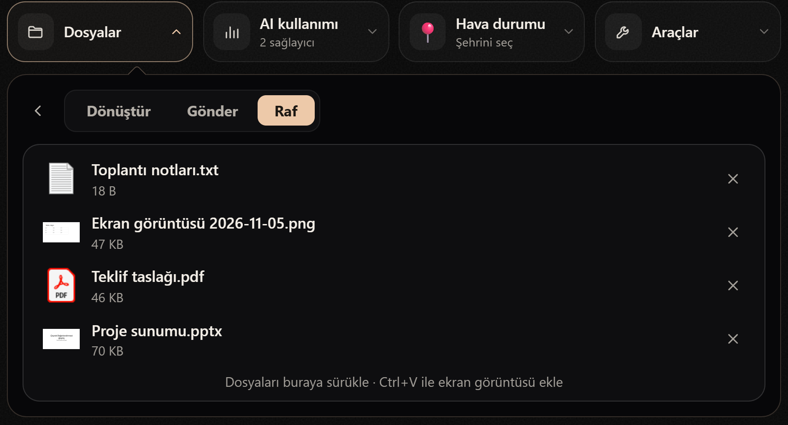
</p>

### All Android devices with Quick Share

Open **Files → Send**, drop or choose files, and press **Send** beside a nearby device. Quick Share supports
two-way transfers between Android devices and computers on the same local
network. Charles remains discoverable while running when receiving is enabled, even with
the panel closed. An incoming request opens the accept/reject panel immediately.
Quick Share must be available and enabled on the Android device.

<p align="center">
  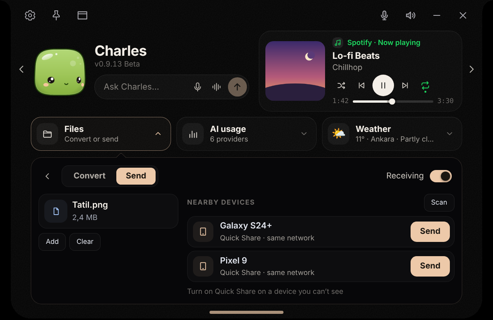
</p>

- **Receiving switch on:** enabled at startup; every file still needs your approval. It stays on while Slime sleeps or the sharing panel is closed.
- **Switch off:** disables receiving and visibility until you enable it again or restart Charles. Sending remains available.

<p align="center">
  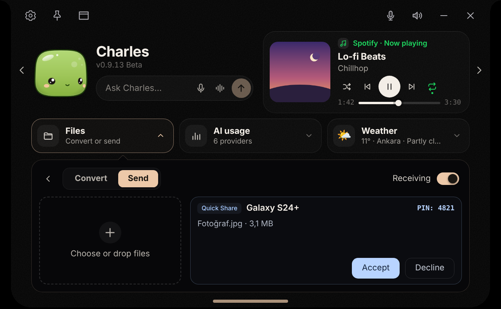
</p>

Received files go to Downloads; an existing file with the same name is preserved. Transfers have
been tested successfully on Samsung and other Android brands. Apple devices (iPhone, iPad and Mac)
use the **LocalSend app** to share files with Charles on the same local network. Native Apple
AirDrop/AWDL is not supported on Windows.

*Screenshots use sample file, device and status data.* [Sharing guide](docs/SHARING.md)

## Highlights

### An assistant that does things

- **Island:** a thin strip at the top of the screen (a small notch with music controls while
  a song plays) opens into the home page and grows down into the chat.
- **Converter:** drop files on the island to turn them into other formats: pictures, audio,
  video, Word/Markdown/PDF text, CSV/JSON, subtitles, ZIP. Offline, saved next to the original.
- **Your own AI accounts:** chat with **ChatGPT (Codex)**, **Claude**, **Antigravity**, **Cursor** or
  **Abacus AI** and switch models from the message box. Pictures work with GPT, Claude and
  Antigravity. Long chats keep their whole history, even on models without a thread of their own.
- **Projects:** chats in a project know each other. Charles sees the project’s instructions
  and what was said and decided in its other chats. Folders keep everything else tidy.
- **Project mode:** pick a folder and let the AI write code in it, with your approval first.
- **Right-click on text:** select text in a message, a code block or a text box and right-click
  for **Copy**, **Paste** and **Ask Charles**. Ask Charles puts the selection in the message box as
  a quote and waits for your question.
- **WhatsApp in Charles** *(experimental)*: link WhatsApp once with a QR code. New messages
  appear under the island, with quick replies and a reply box; nothing is sent until you press
  send. Typed or spoken *“send Mom ‘I’m on my way’ on WhatsApp”* works too.
- **Voice:** say **“Hey Charles”**. Gemini Live for real-time talk, local Whisper for dictation,
  and a microphone button that switches all listening off.
- **Mail and calendar:** Gmail, Google Calendar, Outlook or any POP3/IMAP mailbox. Important
  mail appears as a bubble under the island and opens in its own chat.
- **Notifications that stay visible:** WhatsApp, mail and reminder cards appear under the island,
  beside a tall panel, or in the corner of the app window, without taking the keyboard from what
  you are typing.
- **App window:** chats with projects and folders, an overview you arrange yourself (Spotify,
  reminders, calendar, mail, smart home, usage, system, notes, quick commands, **modules**),
  and a side panel for files, code and terminal output.
- **Modules:** add tools that open in their own window from a `.zip` (study planner, downloads,
  a game master…). Every ability goes through a permission you approve. Modules can use
  Charles’ own Slime, his reactions and accessories ([docs/MODULES.md](docs/MODULES.md)).
- **Updates you can read:** after an update, a card opens what changed in that version. The notes
  come from your computer, so they work with no AI; **Let Charles explain** is optional.
- **Little things:** copy formulas as LaTeX or Word equations, add instructions while the AI is
  still working, reminders and focus timers, weather, screen capture, Home Assistant, and
  in-app updates from GitHub.

### A character with personality

- More than 20 expressions and work animations: in love, dizzy, sleeping, researching with a
  magnifier, coding, drawing, getting an idea 💡 and more.
- **Slime studio:** seven colours, a moustache, and hats, glasses and other accessories to mix
  and match. Seasonal hats come on their own.
- **Desktop pet:** drag Slime onto your desktop, throw him and watch him bounce like jelly. From
  the app window or the open island he leaves his place empty and everything else stays where it
  is; double-click him to send him home. After reading a page or document he goes back by himself.
- Interface in **English, Turkish, German, French, Spanish and Chinese**.

## Modules

<p align="center">
  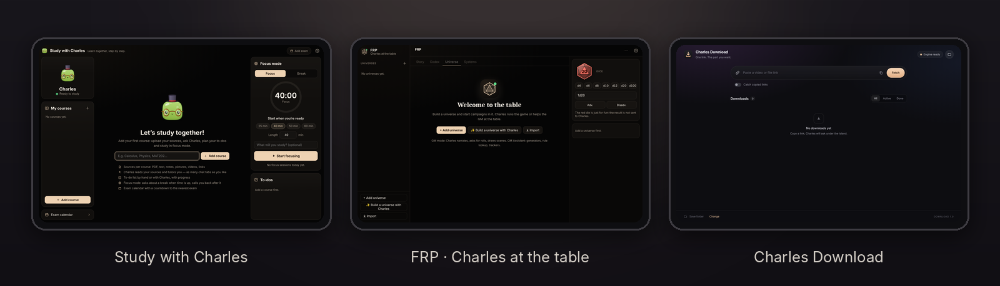
</p>

Modules add whole new tools to Charles, each in its own window: **Study with Charles** (courses,
sources, a tutor that reads them, focus timer, exam countdown), **FRP** (Charles runs your
tabletop game or helps the GM) and **Charles Download** (videos, audio or just the part you
want). Install them from a `.zip` in **Settings → Modules**; the open ones are one click away on
the **Modules** card of the overview.

**Get the official modules:** [**Releases → Modules**](https://github.com/ardadgnyt/ProjectCharles/releases#release-Modules)

**Build your own:** anyone can make a module. A module is a small web page with a
`manifest.json`; through Charles it can ask the user’s AI (with pictures), create images, speak,
keep its own files, show notifications, use Charles’ download engine, and draw Slime with his
accessories, reactions and cursor tracking — every ability behind a permission the user
approves. See [docs/MODULES.md](docs/MODULES.md).

### AI usage and weather

**AI usage** shows every connected AI (Codex, Claude, Antigravity, Cursor, Abacus AI, EVREN)
with its two windows and when they reset. **Weather** shows the current conditions, the next
hours, today and the next five days; the location button changes the city.

<p align="center">
  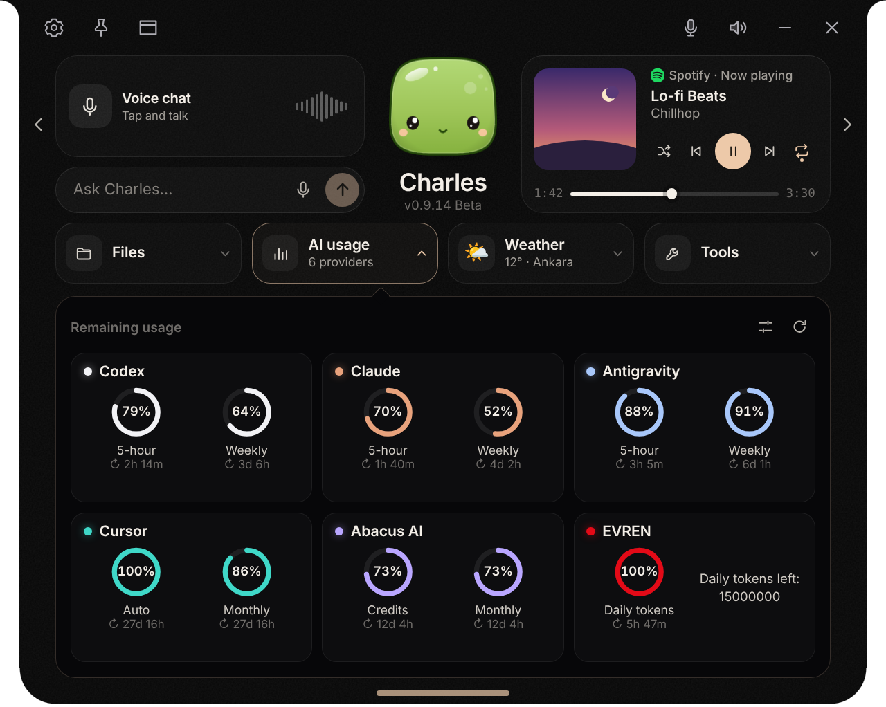
  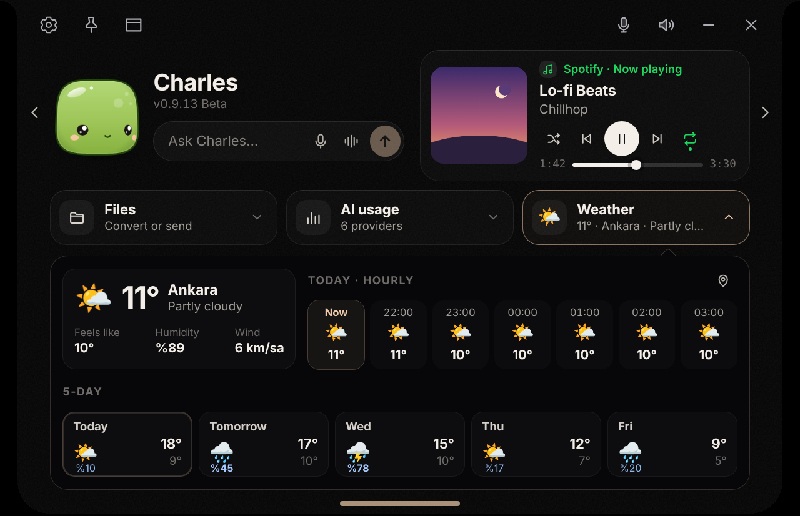
</p>

## Screenshots

<p align="center">
  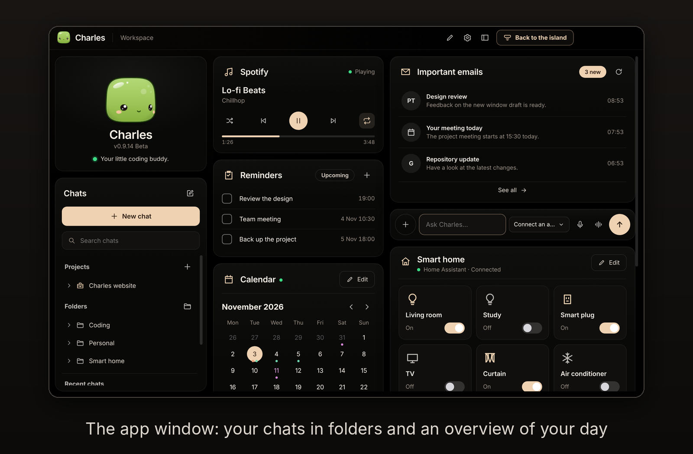
</p>

<p align="center">
  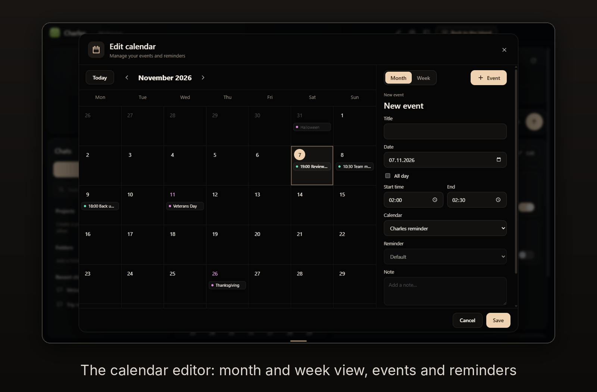
  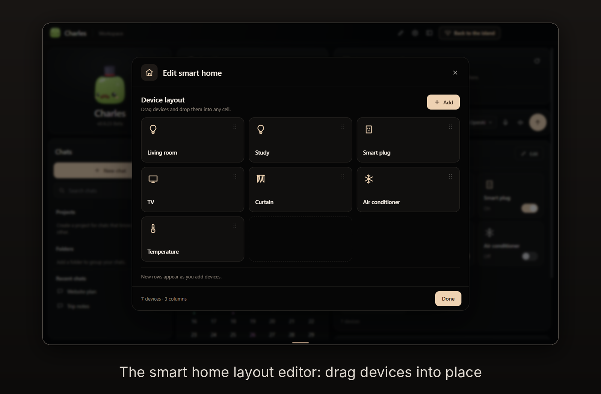
</p>

<p align="center">
  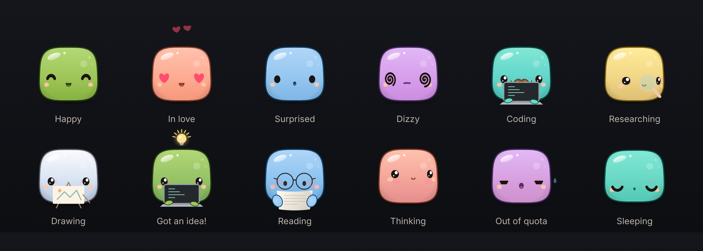
</p>

## Install and update

**Download:** the latest **ProjectCharles-vX.X.X-Beta-Setup.zip** from
[**Releases**](../../releases). Windows 10 or 11 (64-bit), no administrator rights needed.
Already using Charles? **Settings → General → Updates** updates it in place — the in-app
updater works reliably from **v0.8.2** on. · Charles zaten kurulu mu? **Ayarlar → Genel →
Güncellemeler** yerinde günceller; uygulama içi güncelleme **v0.8.2**’den itibaren kararlı
çalışır.

<table>
<tr><td width="50%" valign="top">

#### 🇬🇧 English

1. Download **ProjectCharles-vX.X.X-Beta-Setup.zip** and extract the whole folder.
2. Double-click **Install.cmd** and press Enter.

Requires Windows 10 or 11 (64-bit). No administrator rights needed. If SmartScreen warns you,
choose **More info → Run anyway**.

**Updating from an older version:** use the update option inside Charles — no need to deal
with GitHub — or simply install vX.X.X with the steps above. The in-app update works reliably
from v0.8.2 on; on older versions use the setup once. Your chats, settings and keys stay in
`%APPDATA%\Charles`.

</td><td width="50%" valign="top">

#### 🇹🇷 Türkçe <a id="kurulum-ve-güncelleme"></a>

1. **ProjectCharles-vX.X.X-Beta-Setup.zip** dosyasını indirin ve içindeki tüm klasörü dışa aktarın.
2. **Install.cmd** dosyasına çift tıklayın ve Enter tuşuna basın.

Windows 10 veya 11 (64-bit) gerektirir. Yönetici izni gerekmez. Windows SmartScreen bir
uyarı verirse **Daha fazla bilgi → Yine de çalıştır** seçeneğini belirleyin.

**Daha eski bir sürümden güncelleme:** Charles içindeki güncelleme seçeneğiyle GitHub ile
uğraşmadan güncelleyebilir ya da vX.X.X sürümünü yukarıdaki adımlarla kurabilirsiniz.
Uygulama içi güncelleme v0.8.2’den itibaren kararlı çalışır; daha eski sürümlerde bir kez
kurulumu kullanın.
Sohbetleriniz, ayarlarınız ve anahtarlarınız `%APPDATA%\Charles` dizininde korunur.

</td></tr>
<tr><td valign="top">

#### 🇩🇪 Deutsch

1. Lade **ProjectCharles-vX.X.X-Beta-Setup.zip** herunter und entpacke den gesamten Ordner.
2. Doppelklicke auf **Install.cmd** und drücke die Eingabetaste (Enter).

Erfordert Windows 10 oder 11 (64-Bit). Es sind keine Administratorrechte erforderlich. Falls
eine SmartScreen-Warnung erscheint, wähle **Weitere Informationen → Trotzdem ausführen**.

**Aktualisierung von einer älteren Version:** Du kannst das Update direkt über die
entsprechende Option in Charles durchführen – ohne den Umweg über GitHub – oder einfach
Version vX.X.X mit den Schritten oben installieren. Das In-App-Update funktioniert ab v0.8.2
zuverlässig; bei älteren Versionen nutze einmal das Setup. Deine Chats, Einstellungen und Schlüssel
bleiben in `%APPDATA%\Charles` erhalten.

</td><td valign="top">

#### 🇫🇷 Français

1. Téléchargez **ProjectCharles-vX.X.X-Beta-Setup.zip** et extrayez le contenu du dossier.
2. Double-cliquez sur **Install.cmd** et appuyez sur la touche Entrée.

Nécessite Windows 10 ou 11 (64 bits). Aucun droit d’administrateur n’est requis. Si
SmartScreen affiche un avertissement, sélectionnez **Informations complémentaires → Exécuter
quand même**.

**Mise à jour depuis une version antérieure :** utilisez l’option de mise à jour dans
Charles — sans passer par GitHub — ou installez simplement la version vX.X.X avec les étapes
ci-dessus. La mise à jour intégrée fonctionne de façon fiable depuis la v0.8.2 ; sur les
versions plus anciennes, utilisez une fois l’installateur. Vos discussions, paramètres et clés sont conservés dans `%APPDATA%\Charles`.

</td></tr>
<tr><td valign="top">

#### 🇪🇸 Español

1. Descarga **ProjectCharles-vX.X.X-Beta-Setup.zip** y extrae todo el contenido de la carpeta.
2. Haz doble clic en **Install.cmd** y pulsa Enter.

Requiere Windows 10 u 11 (64 bits). No se necesitan privilegios de administrador. Si aparece
una advertencia de SmartScreen, selecciona **Más información → Ejecutar de todas formas**.

**Actualización desde una versión anterior:** usa la opción de actualización dentro de
Charles —sin recurrir a GitHub— o instala la versión vX.X.X con los pasos de arriba. La
actualización integrada funciona de forma estable desde la v0.8.2; en versiones anteriores usa
el instalador una vez. Tus
chats, configuraciones y claves se conservan en `%APPDATA%\Charles`.

</td><td valign="top">

#### 🇨🇳 简体中文

1. 下载 **ProjectCharles-vX.X.X-Beta-Setup.zip** 并解压整个文件夹。
2. 双击 **Install.cmd**，然后按回车键 (Enter)。

需使用 Windows 10 或 11（64 位）系统。无需管理员权限。如果出现 SmartScreen 提示，请选择
“更多信息” (More info) → “仍要运行” (Run anyway)。

**从旧版本更新：** 您可以通过 Charles 软件内的更新选项直接更新（无需访问 GitHub），或者按照上面的
步骤安装 vX.X.X 版本。应用内更新自 v0.8.2 起可稳定使用；更早的版本请先用安装包安装一次。您的聊天记录、设置和密钥均保存在 `%APPDATA%\Charles` 目录下，不会丢失。

</td></tr>
</table>

The installer asks for its language first (English by default), copies Charles to
`C:\ProjectCharles vX.X.X Beta` (you can pick another folder), creates Desktop and Start menu
shortcuts and starts Charles. Then sign in with your AI account in **Settings → AI models**.
· Kurulum önce dilini sorar, Charles’ı `C:\ProjectCharles vX.X.X Beta` klasörüne kopyalar
(başka bir klasör seçebilirsin), Masaüstü ve Başlat kısayollarını oluşturup Charles’ı açar.
Sonra **Ayarlar → Yapay zekâ modelleri**’nden hesabınla giriş yap.

| File · Dosya | What it does · Ne yapar |
| --- | --- |
| `setup/Install.cmd` | Installs Charles · Charles’ı kurar |
| `setup/install.ps1` | The installer itself · Kurulumun kendisi |
| `setup/Create-Desktop-Shortcut.vbs` | Desktop shortcut for this folder · Bu klasör için masaüstü kısayolu |
| `setup/Reset-Charles.cmd` | Backs up and resets settings and chats (asks first) · Ayarları ve sohbetleri yedekleyip sıfırlar (önce sorar) |
| `Start-Charles.cmd` | Starts Charles from its folder · Charles’ı klasöründen başlatır |

## Running from source

The repository holds the source code and the download tools for Charles Download
(`tools/download/`: yt-dlp and FFmpeg, see `licenses/download/`); `node_modules/`, `dist/`, the
speech models and the other helper tools are created or downloaded on your machine. You need
[Node.js](https://nodejs.org) 22 or newer.

```cmd
git clone https://github.com/HzPederPan/ProjectCharles.git
cd ProjectCharles
npm ci
npm run setup
npm run build
npm start
```

| Command | Purpose |
| --- | --- |
| `npm run setup:voice` | Optional: whisper.cpp and the speech model (~500 MB) |
| `npm test` | Automated tests |
| `npm run dev` | Build the interface and start Electron |
| `python scripts/package.py <folder> <out.zip>` | `Charles.zip` for the installer |
| `npm run release:pack` | `charles-update-<version>.zip` + `.sha256` for in-place updates |

The Antigravity and Cursor sign-in helpers come with the release package. Abacus AI
uses its own `abacusai` command line tool
([setup page](https://abacus.ai/help/abacusai-desktop/cli-installation)).

## Your data and privacy

- Chats, memory, settings and **all keys and account connections** live in
  **`%APPDATA%\Charles`**, never in the app folder; keys are encrypted with Windows (DPAPI).
- Updates and new installs keep your data. **Settings → Account** opens this folder and can
  remove connections or reset everything (it asks first and keeps a backup).
- Mail, calendar and Drive connections are **read-only**; incoming content never runs
  commands.
- **WhatsApp** messages stay in memory only. The open-source gateway is downloaded only when you
  turn the feature on, checked against its SHA-256 and runs on this computer only.
- The microphone button turns off Hey Charles, dictation, push to talk and voice chat. Your
  messages go only to the AI provider you choose.
- **Push to talk** uses local speech recognition. **System monitor** readings stay in memory.
  **Dropping Charles on content** reads it only at that moment, never in the background, and it
  leaves your computer only when you send a question.

## Project layout

```text
ProjectCharles/
├── Start-Charles.cmd     start Charles from this folder
├── setup/                installer, shortcut, reset
├── app/                  Electron main process: AI, plugins, modules, voice
├── src/                  interface (TypeScript) → dist/renderer.js
│   ├── vendor/slime/     the Slime character
│   └── module-kit/       Slime for module windows
├── public/               HTML, CSS, sounds, icons
├── scripts/              build, packaging, voice setup
├── test/                 automated tests
└── docs/                 guides and README images
```

## Documentation

| Document | Contents |
| --- | --- |
| [CHANGELOG.md](CHANGELOG.md) | What changed in every version (English from v0.9.18; older entries are in Turkish) |
| [DEVELOPMENT.md](DEVELOPMENT.md) | Code tour, data files, build and test |
| [docs/USER-GUIDE.md](docs/USER-GUIDE.md) | Chat, project mode, voice, Slime, settings, shortcuts |
| [docs/SHARING.md](docs/SHARING.md) | Quick Share and LocalSend |
| [docs/PLUGINS-SETUP.md](docs/PLUGINS-SETUP.md) | Google, Microsoft, mail, Home Assistant |
| [docs/ARCHITECTURE.md](docs/ARCHITECTURE.md) | How the parts fit together |
| [docs/MODULES.md](docs/MODULES.md) | Writing modules: package, permissions, API, Slime kit |
| [docs/UPDATES.md](docs/UPDATES.md) | In-place updates from GitHub Releases |

## Credits

- Charles’s design is inspired by **Charles** from the *Epic Minequest* series on
  [Sam Green’s YouTube channel](https://www.youtube.com/@SamGreen). Project Charles is a
  fan-inspired, independent project, not affiliated with or endorsed by Sam Green.

## License

Copyright © 2026 **HzPederPan**.

The source code is licensed under **GNU GPL v3 or later**. You may use, modify
and redistribute it under that license, including commercially. Distributed
builds include the corresponding Charles source and build scripts. Third-party
components retain their notices. Artwork and names are described separately in
[LICENSE-ASSETS.md](LICENSE-ASSETS.md). See also [LICENSE](LICENSE) and
[THIRD-PARTY-NOTICES.md](THIRD-PARTY-NOTICES.md).

Charles is an independent project. It is not affiliated with OpenAI, Anthropic, Google,
Cursor, Abacus AI or WhatsApp.
