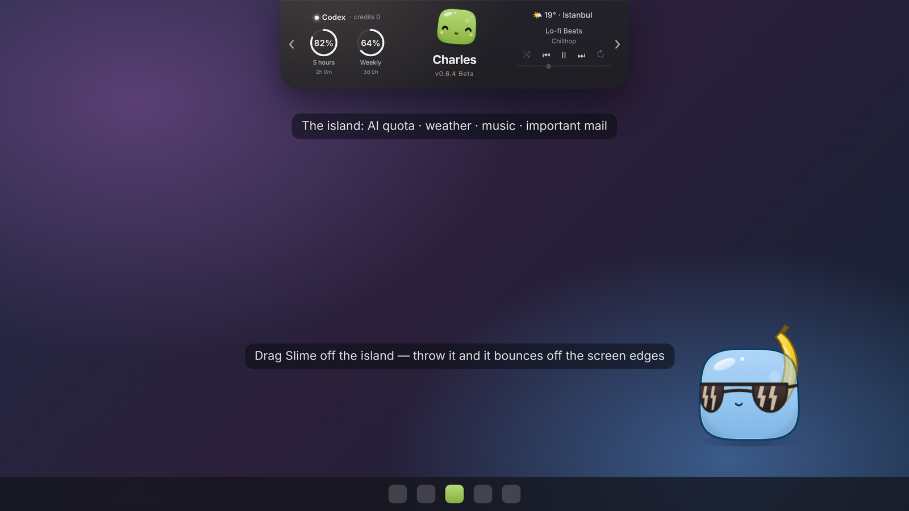

<p align="center">
  
</p>

<p align="center">
  
  
  
  
</p>

**Charles** is a desktop AI companion for Windows. A small *island* sits at the top of your
screen with your AI quota, the weather, your music and important mail. Click it and it opens
into a chat and project workspace. Living on top of it all is **Slime**, a jelly character
who reacts to what you and the AI are doing. Slime thinks while the AI thinks, codes on a
tiny laptop while the AI writes code, and gets dizzy if you shake it too hard.

> Charles’s design is inspired by **Charles** from Sam Green’s *Epic Minequest* series on
> [YouTube](https://www.youtube.com/@SamGreen).

---

## Contents

- [Highlights](#highlights)
- [Screenshots](#screenshots)
- [Installation](#installation)
- [Running from source](#running-from-source)
- [Your data and privacy](#your-data-and-privacy)
- [Project layout](#project-layout)
- [Documentation](#documentation)
- [Credits](#credits)
- [License](#license)

## Highlights

**An assistant that does things**

- Chat with **ChatGPT (Codex)**, **Claude**, **Gemini** or **Cursor**, using your own accounts.
  Switch models from the message box. When one provider runs low on quota, Charles suggests
  another.
- **Project mode:** pick a folder and let the AI write code in it. Every file change and
  command can ask for your approval first.
- **Voice:** say **“Hey Charles”** to start talking. The wake word is detected on your PC.
  Gemini Live handles real-time conversations, and local Whisper handles dictation.
- **Mail and calendar:** connect Gmail and Google Calendar, Outlook, or any POP3/IMAP school or
  work mailbox. Important emails appear as a bubble under the island. Ask
  *“Do I have any important emails?”* and Charles summarises them. It can also turn a deadline
  into a calendar reminder.
- **Built-in helpers:** reminders and focus timers, weather (Open-Meteo), Spotify controls,
  screen-region capture (Ctrl + Shift + S), a memory you control, a weekly activity summary,
  and Home Assistant, GitHub, Notion, Vercel, Stripe, Resend, Cal.com and n8n integrations.

**A character with personality**

- More than 20 expressions and work animations: happy, in love, dizzy, sleeping, researching
  with a magnifier, coding on a laptop, drawing, getting an idea 💡 and more.
- **Slime studio:** seven colours, an optional moustache, and hats, glasses and other
  accessories you can mix and match. Seasonal hats appear on their own. Sunglasses slide up
  onto the forehead when Slime makes a face.
- **Desktop pet:** drag Slime off the island onto your desktop. Throw it and it flies, bounces
  off the screen edges and wobbles like jelly. Poke it with the cursor and it shivers.
- A friendly welcome tour on first launch, plus a full **English and Turkish** interface.

## Screenshots

<p align="center">
  
</p>

<p align="center">
  
</p>

<p align="center">
  
</p>

## Installation

**Requirements:** Windows 10 or 11 (64-bit). No administrator rights are needed.

### Ready-made package (recommended)

1. Download the installer kit from [**Releases**](../../releases). It contains `Install.cmd`,
   `install.ps1` and `Charles.zip`.
2. Extract it and double-click **`Install.cmd`**.
3. The installer checks your Windows, copies Charles to `C:\ProjectCharles v0.6.4 Beta` (you
   can choose another folder), creates Desktop and Start menu shortcuts, and starts Charles.
4. In Charles, sign in with the AI account you want to use (**Settings → Account**).

### Setup tools

The [`setup/`](setup) folder holds everything for installing and maintaining Charles:

| File | What it does |
| --- | --- |
| `setup/Install.cmd` | Installs Charles. It also works when run from inside a complete Charles folder. |
| `setup/install.ps1` | The installer itself, started by `Install.cmd`. |
| `setup/Create-Desktop-Shortcut.vbs` | Creates a desktop shortcut for this Charles folder. |
| `setup/Reset-Charles.cmd` | Backs up and resets settings and chat history. It asks before doing anything. |

To start Charles from its folder, run **`Start-Charles.cmd`**.

## Running from source

The repository contains source code only. `node_modules/`, `dist/`, the speech models in
`models/` and the helper tools in `tools/` are created or downloaded on your machine.

You need [Node.js](https://nodejs.org) 22 or newer.

```cmd
git clone https://github.com/HzPederPan/ProjectCharles.git
cd ProjectCharles
npm ci
npm run setup
npm run build
npm start
```

| Command | Purpose |
| --- | --- |
| `npm run setup:voice` | Optional: downloads whisper.cpp and the speech model (about 500 MB) for local dictation. |
| `npm test` | Runs the automated test suite (`node --test`). |
| `npm run dev` | Builds the interface and starts Electron directly. |
| `python scripts/package.py <folder> <out.zip>` | Builds `Charles.zip` for the installer kit. |

The Gemini (Antigravity) and Cursor sign-in helpers are bundled in the release package. They
are not part of this repository.

## Your data and privacy

- Chats, memory, settings and **all API keys and account connections** are stored in
  **`%APPDATA%\Charles`**, never in the app folder. Keys and passwords are encrypted with
  Windows (DPAPI).
- Updating Charles or installing a new version in another folder keeps your data.
  `setup/Reset-Charles.cmd` makes a backup before it resets anything.
- Mail, calendar and Drive connections are **read-only**. Incoming content can never run
  commands on its own.
- The weather location is sent to Open-Meteo. Your messages go only to the AI provider you
  choose.
- `.gitignore` keeps personal files, logs and large downloads out of the repository.

## Project layout

```text
ProjectCharles/
├── Start-Charles.cmd     start Charles from this folder
├── setup/                installer, desktop shortcut, reset
├── app/                  Electron main process (Node.js): AI providers, plugins, voice, system
├── src/                  interface (TypeScript), bundled into dist/renderer.js
│   └── vendor/slime/     the Slime character: engine, shapes, accessories
├── public/               HTML, CSS, sounds and icons, copied into dist/
├── scripts/              build, start, packaging and voice-setup scripts
├── test/                 automated tests
└── docs/                 guides and README images
```

## Documentation

| Document | Contents |
| --- | --- |
| [CHANGELOG.md](CHANGELOG.md) | What changed in every version (Turkish) |
| [DEVELOPMENT.md](DEVELOPMENT.md) | Code tour, data files, build and test (Turkish) |
| [docs/USER-GUIDE.md](docs/USER-GUIDE.md) | User guide: chat, project mode, voice, Slime, settings, shortcuts |
| [docs/PLUGINS-SETUP.md](docs/PLUGINS-SETUP.md) | Connecting Google, Microsoft, mail and Home Assistant |
| [docs/ARCHITECTURE.md](docs/ARCHITECTURE.md) | How the parts fit together |

## Credits

- Charles’s design is inspired by **Charles** from the *Epic Minequest* video series on [Sam Green’s YouTube channel](https://www.youtube.com/@SamGreen). Project Charles is a fan-inspired, independent project and is not affiliated with or endorsed by Sam Green.
- Parts of the character engine are derived from MIT-licensed code (see [LICENSE](LICENSE)).

## License

Copyright © 2026 **HzPederPan**. All rights reserved.

You may download, run and study Charles for personal, non-commercial use. Redistribution,
modified versions and commercial use require written permission. Parts of the character
engine are derived from MIT-licensed code, and third-party components keep their own
licenses. See [LICENSE](LICENSE), [LICENSE-ASSETS.md](LICENSE-ASSETS.md) and
[THIRD-PARTY-NOTICES.md](THIRD-PARTY-NOTICES.md).

Charles is an independent project. It is not affiliated with OpenAI, Anthropic, Google or
Cursor.
