<p align="center">
  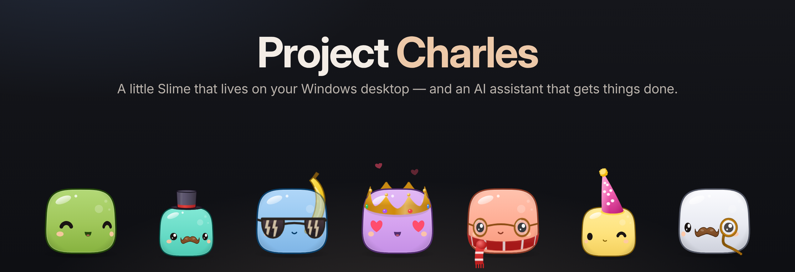
</p>

<p align="center">
  
  
  <a href="LICENSE"></a>
  
  
</p>

<p align="center">
  <a href="#install-and-update">Install</a> ·
  <a href="#features">Features</a> ·
  <a href="#modules">Modules</a> ·
  <a href="#your-data-and-privacy">Privacy</a> ·
  <a href="CHANGELOG.md">Changelog</a> ·
  <a href="docs/USER-GUIDE.md">User guide</a>
</p>

**Charles** is a desktop AI companion for Windows. A small *island* sits at the top of your
screen with your AI quota, the weather, your music and important mail. Click it and it opens
into a chat and project workspace. Living on top of it all is **Slime**, a jelly character
who reacts to what you and the AI are doing: he thinks while the AI thinks, codes on a tiny
laptop while it writes code, and gets dizzy if you shake him too hard.

Charles uses the AI accounts you already have. It does not come with a model of its own and has
no account of its own to sign up for.

> Charles’s design is inspired by **Charles** from Sam Green’s *Epic Minequest* series on
> [YouTube](https://www.youtube.com/@SamGreen).

<p align="center">
  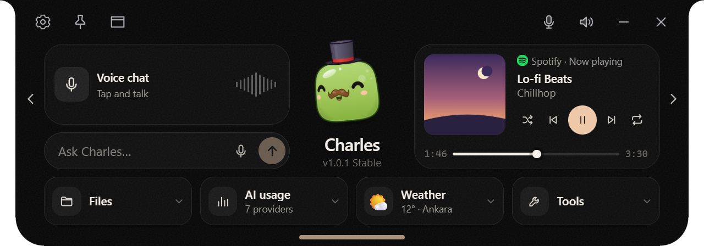
</p>

## Contents

- [At a glance](#at-a-glance)
- [Install and update](#install-and-update)
- [Features](#features)
  - [The island](#the-island)
  - [Chat and AI accounts](#chat-and-ai-accounts)
  - [Projects and project mode](#projects-and-project-mode)
  - [The app window](#the-app-window)
  - [Voice](#voice)
  - [Ask about what is on your screen](#ask-about-what-is-on-your-screen)
  - [Files: convert, shelf, share](#files-convert-shelf-share)
  - [Tools](#tools)
  - [AI usage, weather and the usage summary](#ai-usage-weather-and-the-usage-summary)
  - [Mail, calendar, WhatsApp and smart home](#mail-calendar-whatsapp-and-smart-home)
  - [Slime](#slime)
  - [Settings](#settings)
  - [Keyboard shortcuts](#keyboard-shortcuts)
- [Modules](#modules)
- [Your data and privacy](#your-data-and-privacy)
- [Running from source](#running-from-source)
- [Project layout](#project-layout)
- [Documentation](#documentation)
- [Credits](#credits) · [License](#license)

## At a glance

| Area | What you get |
| --- | --- |
| **Island** | A strip at the top of the screen that opens into a card shelf and a chat; Large or Small; docks left, right or centre; notification cards appear under it |
| **AI accounts** | ChatGPT (Codex), Claude, Antigravity, Cursor, Abacus AI, EVREN and GitHub Copilot, each with your own account; switch models from the message box |
| **App window** | Chats in projects and folders, a home page with the message box on top and cards you arrange in two columns, a side panel for files, code and terminal output |
| **Voice** | “Hey Charles”, real-time voice chat, dictation, and push to talk that types into any app |
| **Screen content** | Drop Charles on a page, a document or a mail and ask about it |
| **Files** | An offline converter, a shelf for files you need later, Quick Share with Android and LocalSend with Apple devices |
| **Tools** | Color picker, timer, reminders, calendar, emails, usage summary, smart home, system monitor |
| **Accounts** | Gmail, Google Calendar and Drive, Outlook, POP3/IMAP mail, Home Assistant, WhatsApp |
| **Slime** | More than 20 expressions and work animations, colours and accessories, a desktop pet |
| **Modules** | Extra tools in their own windows, installed from a `.zip`, each ability behind a permission |
| **Languages** | English, Turkish, German, French, Spanish, Chinese |
| **Privacy** | Your data stays in `%APPDATA%\Charles`; keys are encrypted by Windows; messages go only to the AI you choose |

## Install and update

Download **CharlesSetup.exe** from [**Releases**](../../releases). There is no zip to unpack and no
command window: the setup is one program.

<table>
<tr><td width="50%" valign="top">

#### 🇬🇧 English

1. Download **CharlesSetup.exe** from [**Releases**](../../releases) and double-click it.
2. Choose English or Turkish, read and accept the license, choose a folder, then press **Install**.
3. Start Charles and sign in with your AI account in **Settings → AI models**.

**Requirements:** Windows 10 or 11 (64-bit) and about 3 GB of free space. No administrator rights
needed.

**Windows warning:** the setup is not code-signed yet, so Windows SmartScreen may warn you. If you
trust where the file came from, choose **More info → Run anyway**.

**Where it goes:** a new install goes to `%LOCALAPPDATA%\Programs\Charles`; if the setup finds your
Charles folder, it offers that one. It creates Start menu and Desktop shortcuts. The setup opens in
Turkish on a Turkish Windows and in English otherwise; Charles keeps its own language setting.

**Updating:** use **Settings → General → Updates** inside Charles, or run CharlesSetup.exe on your
Charles folder. The in-app update works reliably from v0.8.2 on; on older versions use the setup once.

**Removing:** use **Windows Settings → Apps → Charles**. Your data stays unless you tick the separate
box to delete it. Your chats, settings and keys are kept in `%APPDATA%\Charles`.

</td><td width="50%" valign="top">

#### 🇹🇷 Türkçe <a id="kurulum-ve-güncelleme"></a>

1. **CharlesSetup.exe** dosyasını [**Releases**](../../releases) sayfasından indirin ve çift tıklayın.
2. Türkçe veya İngilizce seçin, lisansı okuyup kabul edin, klasörü seçin ve **Kur** düğmesine basın.
3. Charles’ı başlatın ve **Ayarlar → Yapay zekâ modelleri** bölümünden yapay zekâ hesabınızla giriş yapın.

**Gereksinimler:** Windows 10 veya 11 (64-bit) ve yaklaşık 3 GB boş alan. Yönetici izni gerekmez.

**Windows uyarısı:** kurulum henüz kod imzalı değildir, bu yüzden Windows SmartScreen uyarı verebilir.
Dosyanın kaynağına güveniyorsanız **Daha fazla bilgi → Yine de çalıştır** seçeneğini belirleyin.

**Nereye kurulur:** yeni kurulum `%LOCALAPPDATA%\Programs\Charles` klasörüne yapılır; kurulum Charles
klasörünüzü bulursa onu önerir. Başlat menüsü ve Masaüstü kısayolları oluşturur. Kurulum, Windows’unuz
Türkçeyse Türkçe, değilse İngilizce açılır; Charles kendi dil ayarını korur. Lisans metinleri
İngilizcedir, onaylanmış bir Türkçe çevirisi yoktur.

**Güncelleme:** Charles içinde **Ayarlar → Genel → Güncellemeler** bölümünü kullanın ya da
CharlesSetup.exe dosyasını Charles klasörünüzde çalıştırın. Uygulama içi güncelleme v0.8.2’den itibaren
kararlı çalışır; daha eski sürümlerde bir kez kurulumu kullanın.

**Kaldırma:** **Windows Ayarları → Uygulamalar → Charles** bölümünü kullanın. Verileriniz, ayrıca
işaretlemediğiniz sürece silinmez. Sohbetleriniz, ayarlarınız ve anahtarlarınız
`%APPDATA%\Charles` dizininde durur.

</td></tr>
<tr><td valign="top">

#### 🇩🇪 Deutsch

1. Lade **CharlesSetup.exe** unter [**Releases**](../../releases) herunter und doppelklicke darauf.
2. Wähle Englisch oder Türkisch, lies und akzeptiere die Lizenz, wähle einen Ordner und klicke auf **Install**.
3. Starte Charles und melde dich unter **Einstellungen → KI-Modelle** mit deinem KI-Konto an.

**Voraussetzungen:** Windows 10 oder 11 (64-Bit) und etwa 3 GB freier Speicherplatz. Es sind keine
Administratorrechte erforderlich.

**Windows-Warnung:** Das Setup ist noch nicht codesigniert, daher kann Windows SmartScreen warnen.
Wenn du der Quelle der Datei vertraust, wähle **Weitere Informationen → Trotzdem ausführen**.

**Speicherort:** Eine neue Installation landet in `%LOCALAPPDATA%\Programs\Charles`; findet das Setup
deinen Charles-Ordner, schlägt es diesen vor. Es legt Verknüpfungen im Startmenü und auf dem Desktop
an. Das Setup selbst gibt es nur auf Englisch und Türkisch; Charles behält seine eigene
Spracheinstellung.

**Aktualisieren:** Nutze **Einstellungen → Allgemein → Updates** in Charles oder führe CharlesSetup.exe
für deinen Charles-Ordner aus. Das In-App-Update funktioniert ab v0.8.2 zuverlässig; bei älteren
Versionen nutze einmal das Setup.

**Entfernen:** Nutze **Windows-Einstellungen → Apps → Charles**. Deine Daten bleiben erhalten, solange
du nicht das separate Kästchen zum Löschen ankreuzt. Chats, Einstellungen und Schlüssel liegen in
`%APPDATA%\Charles`.

</td><td valign="top">

#### 🇫🇷 Français

1. Téléchargez **CharlesSetup.exe** depuis [**Releases**](../../releases) et double-cliquez dessus.
2. Choisissez l’anglais ou le turc, lisez et acceptez la licence, choisissez un dossier et cliquez sur **Install**.
3. Lancez Charles et connectez-vous à votre compte d’IA dans **Réglages → Modèles d’IA**.

**Configuration requise :** Windows 10 ou 11 (64 bits) et environ 3 Go d’espace libre. Aucun droit
d’administrateur n’est requis.

**Avertissement de Windows :** l’installateur n’est pas encore signé, Windows SmartScreen peut donc
afficher un avertissement. Si vous faites confiance à la provenance du fichier, sélectionnez
**Informations complémentaires → Exécuter quand même**.

**Emplacement :** une nouvelle installation va dans `%LOCALAPPDATA%\Programs\Charles` ; si
l’installateur trouve votre dossier Charles, il le propose. Il crée des raccourcis dans le menu
Démarrer et sur le Bureau. L’installateur existe seulement en anglais et en turc ; Charles garde son
propre réglage de langue.

**Mise à jour :** utilisez **Réglages → Général → Mises à jour** dans Charles, ou lancez
CharlesSetup.exe sur votre dossier Charles. La mise à jour intégrée fonctionne de façon fiable depuis
la v0.8.2 ; sur les versions plus anciennes, utilisez une fois l’installateur.

**Désinstallation :** utilisez **Paramètres Windows → Applications → Charles**. Vos données restent
en place, sauf si vous cochez la case distincte pour les supprimer. Vos discussions, paramètres et
clés se trouvent dans `%APPDATA%\Charles`.

</td></tr>
<tr><td valign="top">

#### 🇪🇸 Español

1. Descarga **CharlesSetup.exe** desde [**Releases**](../../releases) y haz doble clic en él.
2. Elige inglés o turco, lee y acepta la licencia, elige una carpeta y pulsa **Install**.
3. Inicia Charles y entra con tu cuenta de IA en **Ajustes → Modelos de IA**.

**Requisitos:** Windows 10 u 11 (64 bits) y unos 3 GB de espacio libre. No se necesitan privilegios de
administrador.

**Aviso de Windows:** el instalador aún no tiene firma de código, así que Windows SmartScreen puede
mostrar un aviso. Si confías en el origen del archivo, selecciona **Más información → Ejecutar de
todas formas**.

**Ubicación:** una instalación nueva va a `%LOCALAPPDATA%\Programs\Charles`; si el instalador encuentra
tu carpeta de Charles, la propone. Crea accesos directos en el menú Inicio y en el Escritorio. El
instalador solo está en inglés y turco; Charles conserva su propio ajuste de idioma.

**Actualizar:** usa **Ajustes → General → Actualizaciones** dentro de Charles, o ejecuta
CharlesSetup.exe sobre tu carpeta de Charles. La actualización integrada funciona de forma estable
desde la v0.8.2; en versiones anteriores usa el instalador una vez.

**Desinstalar:** usa **Configuración de Windows → Aplicaciones → Charles**. Tus datos se conservan
salvo que marques la casilla aparte para borrarlos. Tus chats, ajustes y claves están en
`%APPDATA%\Charles`.

</td><td valign="top">

#### 🇨🇳 简体中文

1. 从 [**Releases**](../../releases) 下载 **CharlesSetup.exe** 并双击运行。
2. 选择英语或土耳其语，阅读并接受许可协议，选择文件夹，然后点击 **Install**。
3. 启动 Charles，在 **设置 → AI 模型** 中登录您的 AI 账户。

**系统要求：** Windows 10 或 11（64 位），约 3 GB 可用空间。无需管理员权限。

**Windows 提示：** 安装程序尚未进行代码签名，因此 Windows SmartScreen 可能会显示警告。如果您信任文件来源，请选择“更多信息” (More info) → “仍要运行” (Run anyway)。

**安装位置：** 全新安装的目录为 `%LOCALAPPDATA%\Programs\Charles`；如果安装程序找到您的 Charles 文件夹，会建议使用该文件夹。它会创建开始菜单和桌面快捷方式。安装程序只有英语和土耳其语界面；Charles 保留自己的语言设置。

**更新：** 在 Charles 中打开 **设置 → 常规 → 更新**，或在您的 Charles 文件夹上运行 CharlesSetup.exe。应用内更新自 v0.8.2 起可稳定使用；更早的版本请先用安装程序安装一次。

**卸载：** 打开 **Windows 设置 → 应用 → Charles**。除非您勾选单独的删除选项，否则数据会保留。您的聊天记录、设置和密钥保存在 `%APPDATA%\Charles` 目录下。

</td></tr>
</table>

| File · Dosya | What it does · Ne yapar |
| --- | --- |
| `CharlesSetup.exe` | Installs Charles · Charles’ı kurar |
| `Uninstall Charles.exe` | Removes Charles (also in Windows Settings → Apps) · Charles’ı kaldırır (Windows Ayarları → Uygulamalar’da da var) |
| `setup/Create-Desktop-Shortcut.vbs` | Desktop shortcut for this folder · Bu klasör için masaüstü kısayolu |
| `setup/Reset-Charles.cmd` | Backs up and resets settings and chats (asks first) · Ayarları ve sohbetleri yedekleyip sıfırlar (önce sorar) |
| `Start-Charles.cmd` | Starts Charles from its folder · Charles’ı klasöründen başlatır |

## Features

### The island

The island is a thin strip at the top of the screen. Click it and it opens.

- **Card shelf:** a big **voice chat** card (tap and talk; its bars follow your voice and Charles’),
  a message box with dictation, Charles in the middle with the version under his name, the Spotify
  card, and four cards that open a panel below them:
  - **Files:** three buttons, **Convert**, **Send** and **File shelf**; what each one does is in its tooltip.
  - **AI usage:** every connected AI with its allowance rings and reset times.
  - **Weather:** now, the next hours, today and the next five days in one frame.
  - **Tools:** eight tools as tiles with an icon and a name, then your installed modules.
- **Chat:** the shelf grows down into the chat. Pin it to keep it open, or let it fold when you
  click elsewhere.
- **Closed:** while music plays, the closed island shows the cover, the song and the artist, with
  music controls. A running or finished timer and a colour you just picked also show there.
- **Size and place:** Large or Small (Small is 3/4 of Large, for a laptop screen), in the centre or
  docked to the left or right edge, on the screen you choose. The chat keeps the message you were
  reading when the island moves or changes size.
- **Full-screen programs:** while a game, a film or a presentation fills the display the island is
  on, the island steps back and notification cards wait; they come back when you leave it. With a
  full-screen program on another display, the island stays in front on its own display. While any
  program is full screen, Charles does not take the focus or flash his taskbar button by himself.
- **Tooltips and keyboard:** icon buttons and cut-off names show a small tooltip of Charles’ own on
  hover or keyboard focus, kept inside the island. The first **Tab** offers **Skip to the message
  box**, and the message box, Charles and text fields show a focus ring when reached by keyboard.
- **Welcome tour:** on the first start Charles introduces himself in a few short steps and offers
  every AI connection (ChatGPT, Antigravity, Claude, Cursor, Abacus AI, EVREN and GitHub Copilot).
  Abacus AI, EVREN and GitHub Copilot are set up on their card in Settings, which opens when the
  tour ends. The tour can be started again from **Settings → General**.

### Chat and AI accounts

Sign in to the accounts you have in **Settings → AI models**. Each account card has **Set up with
Charles** (a step-by-step guide beside Slime), a sign-in button (EVREN takes an API key instead) and
**Check connection**. While an account is connected its sign-in button is hidden and the card shows
one status line: a green dot, **Connected** and what the last check said (for example “Models are
ready.”). A sign-in error stays on the card until you act on it.

<p align="center">
  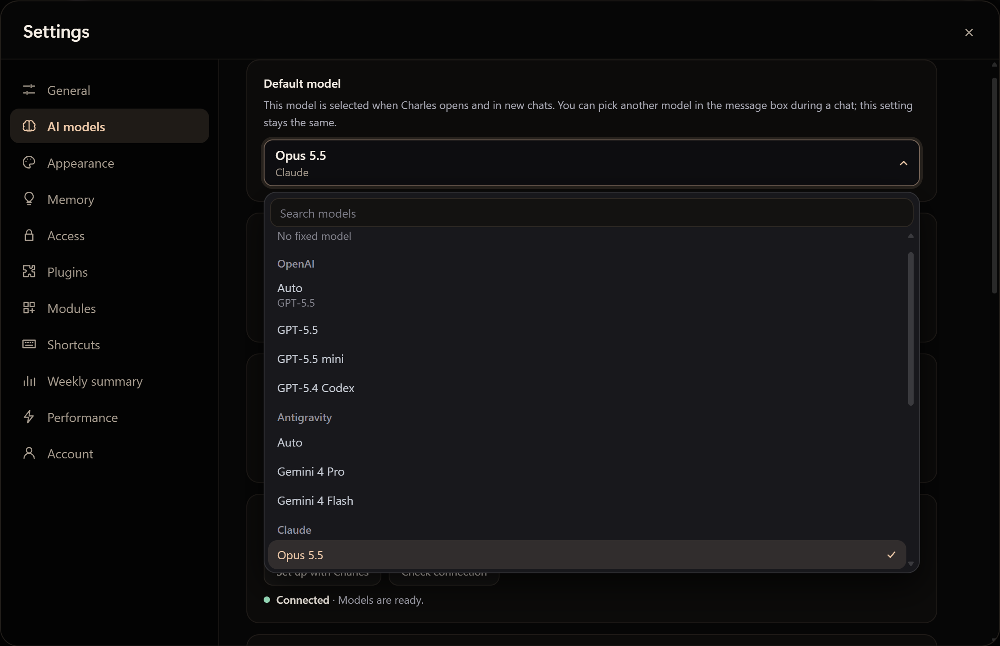
</p>

| Connection | How it connects |
| --- | --- |
| **ChatGPT (Codex)** | Your ChatGPT account, through Codex |
| **Claude** | Your Claude account, through Claude Code (a Pro or Max plan) |
| **Antigravity** | Your Google account, through Antigravity |
| **Cursor** | Your Cursor account, through the official Cursor Agent (chat only) |
| **Abacus AI** | Its own command line tool, which you install yourself |
| **EVREN** | An EVREN API key, stored with Windows encryption |
| **GitHub Copilot** | Its own command line tool (yours, or the one that comes with VS Code); the model list follows your Copilot plan |

Real-time voice chat uses **Gemini Live** with a Gemini API key of its own, set on the same page.

What each connection can do from the **+** menu (a choice the chosen AI cannot do is greyed out):

| Connection | Photos and files | Create image | Web search and deep research |
| --- | --- | --- | --- |
| **ChatGPT (Codex)** | Yes | Yes, its own image generator | Yes |
| **Antigravity** | Yes | Yes, its own image generator | Yes |
| **Claude** | Yes | Yes, drawn as a vector graphic that Charles turns into a picture | Yes |
| **Cursor** | Yes | No | No |
| **Abacus AI** | Yes | No | No |
| **EVREN** | Yes | Yes, drawn as a vector graphic | No |
| **GitHub Copilot** | Yes | Yes, drawn as a vector graphic | No |

In the chat:

- **Models and effort:** switch the AI, the model and, where the model has them, the effort level
  from the message box; the chosen model is shown on the model button itself.
- **Default model:** in **Settings → AI models**, a list of Charles’ own, grouped by AI, with a
  search field when there are many models and full keyboard use (arrows, Enter, Esc). “The model I
  used last” is one of the choices. A saved model that is no longer offered is shown as unavailable,
  with the reason.
- **A new chat** shows one line, “What’s on your mind?”, and two suggestions.
- **Attachments:** files and pictures by drag, paste or the **+** menu; a picture opens large on a click.
- **Creating a picture:** while it is made, an animated card (soft moving colours, a ring with an
  estimated percentage, the step and the seconds) stands in for it; the finished picture replaces it.
- **Steps of an answer:** “Thinking and steps” is one compact line that opens into what Charles did:
  commands, files read, a published reasoning summary when the AI gives one. Once the answer is over,
  the line says how it ended: Done, Partly done (a failed step was never made up for), Not finished,
  or Stopped. A failed step keeps its error when opened.
- **While the AI works:** add an instruction to the running answer, or stop it.
- **Editing:** your own message is as wide as its text, and its edit pencil shows beside it on hover
  or keyboard focus. Edit a message you sent; the chat branches and the older branch is kept.
- **History:** chats live in folders and projects; long chats keep their whole history, also on
  models without a thread of their own. The history header is one row: search, new chat, new folder
  and an **Edit** menu (**Edit with AI** and the **Automatic with AI** switch).
- **Right-click on text:** **Copy**, **Paste** and **Ask Charles**, which puts the selection in the
  message box as a quote.
- **Formulas:** rendered in the chat and copied as LaTeX or as a Word equation.
- **Things you can just say:** reminders, a focus timer, the weather, your mail, a Home Assistant
  device, a web search and more are handled by Charles itself, without asking the AI
  ([list in the user guide](docs/USER-GUIDE.md#things-you-can-just-say)).

### Projects and project mode

- **Projects:** chats in a project know each other. Charles sees the project’s instructions and what
  was said and decided in its other chats.
- **Project mode:** switch from **Chat** to **Project**, choose a folder, and the AI can read and
  change files there and run commands. **Settings → Access** sets how much it may do on its own:
  **Ask for approval**, **Approve for me** (edits inside the project are allowed, anything outside it
  or on the network still asks) or **Full access**.
- **Review:** changed files are listed with a before and after view, and a change can be undone.

### The app window

The same Charles in a normal window, for longer work.

- **Left column:** Charles’ card with his name and the version at the top, then your chats:
  **New chat**, search, folders, projects and recent chats.
- **Home:** the message box at the top at full width, and the cards below it in two columns:
  Spotify, reminders, calendar, important emails, smart home devices as rows, and AI usage. In the
  edit mode (the pencil in the title bar) you can add, move and remove cards: quick commands, notes,
  system usage, system information, modules, colour picker, timer, files and weather are there too.
  **Reset layout** in the edit mode goes back to the default page after asking. A saved layout loads
  as you left it.
- **A chat:** its title row also holds **Chat** / **Project** and the chat’s tools; the work queue
  row appears only when it holds something.
- **Side panel** for files, code and terminal output.
- Settings and the other dialogs stay below the window’s own buttons.
- Moving between the island and the app window keeps your draft, your attachments and your place in
  the chat.

<p align="center">
  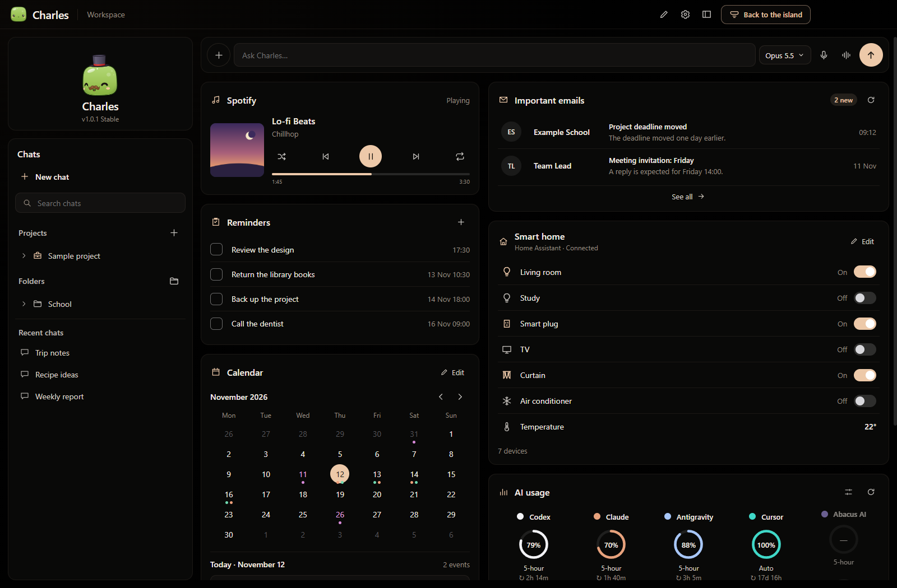
</p>

<p align="center">
  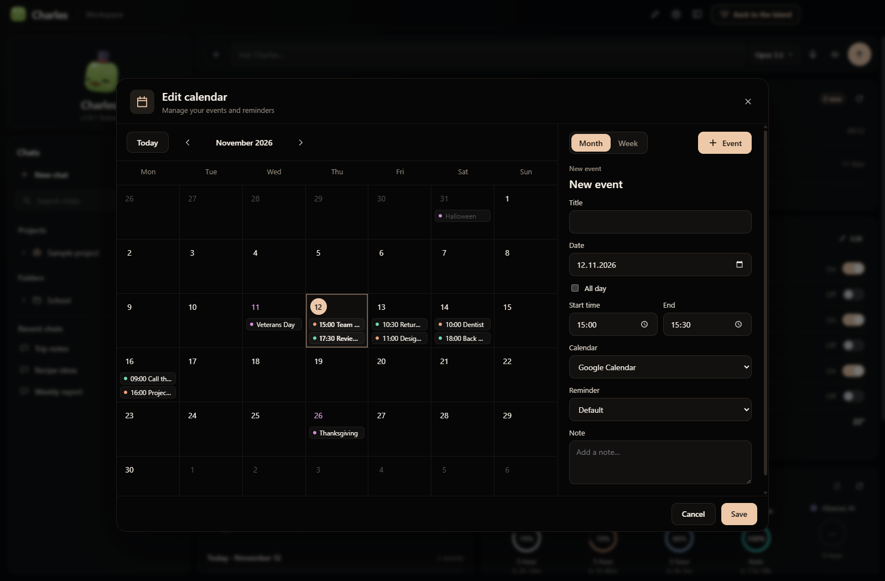
  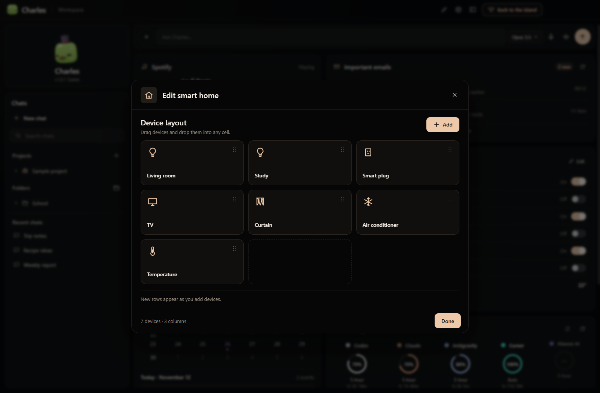
</p>

### Voice

- **Hey Charles:** say it and a voice conversation starts. The phrase is found on your computer
  with the local Whisper model, and a short training (three recordings) teaches it your voice. A
  steady background sound such as a fan does not keep Charles checking for the phrase; the phrase
  said in one breath with a question (“Hey Charles, what time is it?”) goes to the check about three
  seconds after it begins, without waiting for a pause; and a few near
  spellings the speech model writes for it (such as “Hey Chars”) also wake him. Over loud music the
  phrase may still not be heard.
- **Voice chat:** real-time talk through Gemini Live, started from the island’s voice chat card or
  with a shortcut. The card shows who is talking and how long the call has been going.
- **Dictation:** the microphone in the message box turns speech into text with the local Whisper model.
- **Read aloud:** Charles can read answers to you.
- **One switch:** the microphone button in the island’s header turns all listening off.

#### Push to talk

Type with your voice in any app. Turn it on in **Settings → Shortcuts → Push to talk**.

- **Hold Right Arrow + Up Arrow together, speak, let go:** your words are typed at the cursor. Either
  key can go first.
- **Press the pair twice quickly:** hands-free recording; press it again to finish.
- **Esc:** cancels the recording or the text that is on its way.

You can choose another key or combination in the same place: one key, two keys pressed together, or
a combination with Ctrl, Alt, Shift or Win. While the feature is on, either arrow pressed alone still
does its normal job, a moment later. It is off by default and steps aside for full-screen apps such
as games.

Speech is turned into text by the local Whisper model. Audio stays on your computer and no
recording is kept. The clipboard is not used and Enter is never pressed. Password fields and apps
running as administrator are not typed into, and if the focus moves while you speak, the text waits
in a small card so you can copy it or insert it. The status bubble appears right under the island,
where notifications appear, and takes neither the keyboard nor the focus.

### Ask about what is on your screen

Hold Charles over a web page, a document or an email for a moment. A frame shows what he would
read. Let go, and only that one thing is read. A card above the message box then shows the title,
the app and how much was read, with **Summarize**, **Key points** and **What I need to do**; you
can also type your own question. Moving Charles without stopping is just a move, and **Esc** cancels.

Dropping him sends nothing to an AI. Content goes out only when you press a button or send a
question, and the card names the AI it goes to. While the card is open the content goes with each
question; **×** removes it. Text from a page or a file is treated as data, so instructions hidden
in it are not followed: such a turn runs without tools, and web search is off for it.

No browser extension is needed. Charles uses the Windows accessibility interface, so he reads what
an app shares:

| Where | What is read |
| --- | --- |
| Chrome and Edge pages | The loaded text of the page in the active tab (no other tabs); parts that load while scrolling are left out |
| PDFs opened from this computer in Chrome or Edge | The whole file |
| Word and PowerPoint (`.docx`, `.pptx`, `.ppt`) | The saved file, with slide numbers and notes; unsaved changes are not included, and the card says so |
| Notepad and similar editors | The text in the window |
| Adobe Acrobat, and apps that share no text | A picture of that window, marked as the visible part only |
| Web mail | Read as a page |

Other browsers and desktop mail apps depend on what they share and have not been tested. Password
managers and windows with a password field in focus are not read.

<p align="center">
  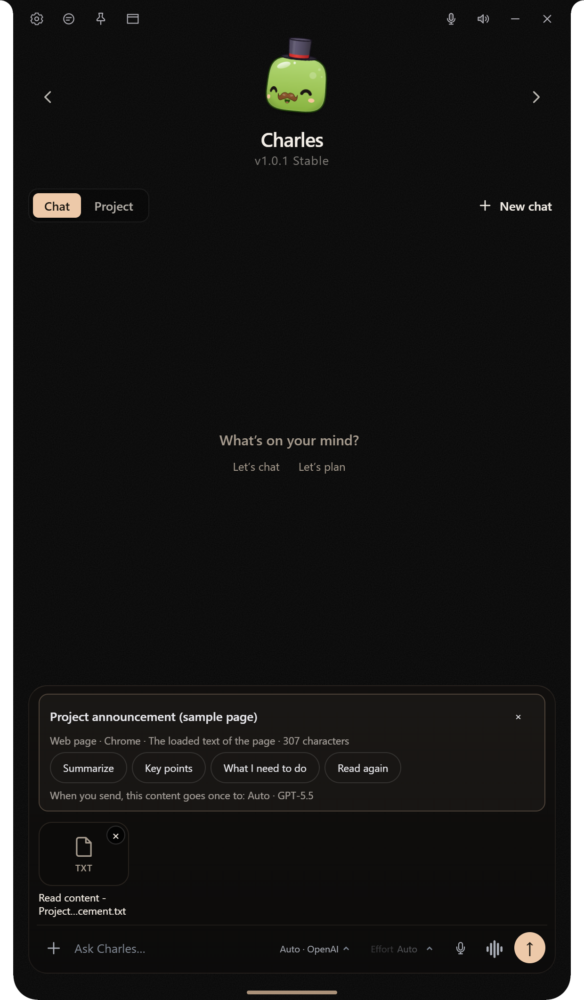
</p>

### Files: convert, shelf, share

#### Convert files on your desktop

Open **Files → Convert** (or drag a file onto the **Files** card: its Convert / Send tiles open
by themselves), choose an output format, then press **Convert**. Everything runs on your computer
and the result is saved beside the original.

- **Documents:** PDF, Word (DOCX, DOC, ODT, RTF), TXT, Markdown, HTML and EPUB into each other;
  PDF into DOCX, XLSX or PPTX; pages as PNG, JPEG or TIFF.
- **Spreadsheets and data:** XLSX, XLS, ODS, CSV, TSV and JSON, with sheet, range, separator,
  encoding and header choices; a sheet as a picture or PDF.
- **Presentations:** PPTX, PPT and ODP into each other and PDF; slides as pictures; text with or
  without speaker notes.
- **Scans:** text recognition with Windows' own OCR into a searchable PDF, TXT or DOCX, and
  tables into XLSX or CSV after you check them.
- **Pictures:** PNG, JPEG, WebP, BMP, TIFF, AVIF, HEIC, SVG, ICO and GIF, PNG or JPEG into a real
  SVG, several pictures into one animation or one PDF in your order.
- **Sound, video and speech:** MP3, WAV, FLAC, M4A, AAC, OGG, Opus, MP4, MKV, MOV, AVI and WebM
  with quality choices; clips to GIF or WebP; speech to TXT, DOCX, SRT or VTT with local Whisper.
- **Archives:** ZIP, 7z, TAR, TAR.GZ, TAR.XZ and RAR extracted, always safely; files and folders
  packed as ZIP, 7z or TAR; an archive repacked as ZIP, 7z, TAR or TAR.GZ. File names that Windows’ own
  archive tool cannot hold (Chinese, Japanese, Korean, Russian, Greek, emoji), also in a folder with
  such a name, work in ZIP, TAR and TAR.GZ, which Charles then reads and writes itself; 7z, TAR.XZ
  and RAR say plainly that they cannot hold such names. Two files with the same name packed together
  as ZIP are both kept.

Only the formats the chosen files can become on this computer are offered. Word, Excel and
PowerPoint are used for their own formats when they are installed. See the
[User Guide](docs/USER-GUIDE.md#converting-files) for the full list.

<p align="center">
  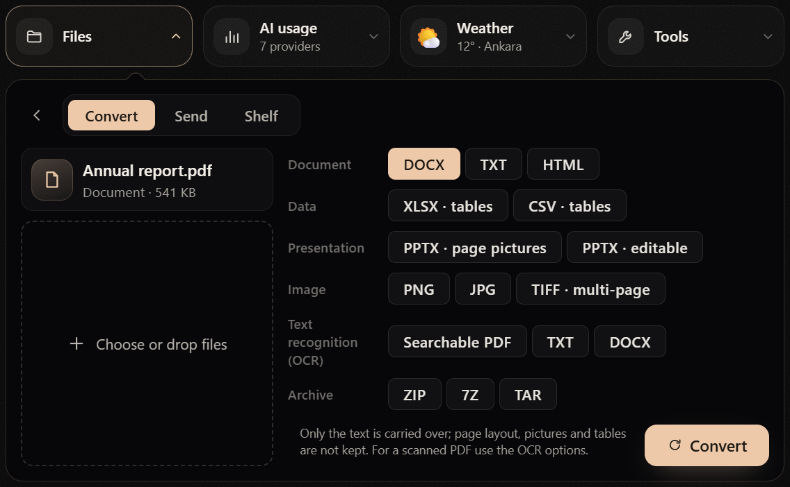
</p>

#### File shelf

Keep files on the island until you need them. Open **Files → File shelf**, then:

- **Add files:** drag them onto the shelf. Charles keeps its own copy, so the original can move or disappear.
- **Paste a screenshot:** with the shelf on screen, press **Ctrl+V**. A picture on the clipboard is saved as a PNG with a preview.
- **Take them out:** drag a row to a folder or another program. It arrives as a real file, and the file’s picture and name follow the pointer on a transparent background.

Files stay on the shelf after a restart, until you remove them.

<p align="center">
  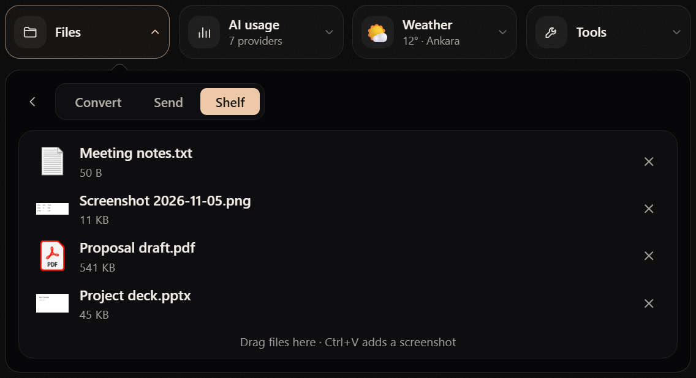
</p>

#### Share with Quick Share and LocalSend

Open **Files → Send**, drop or choose files, and press **Send** beside a nearby device. Quick Share supports
two-way transfers between Android devices and computers on the same local
network. Charles remains discoverable while running when receiving is enabled, even with
the panel closed. An incoming request opens the accept/reject panel immediately.
Quick Share must be available and enabled on the Android device.

<p align="center">
  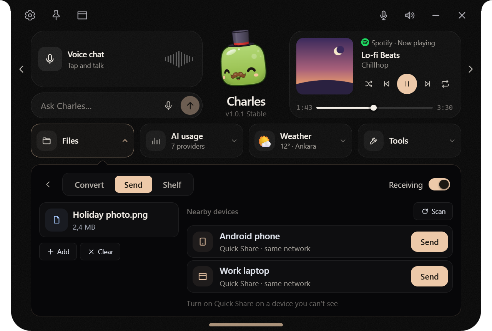
</p>

- **Receiving switch on:** enabled at startup; every file still needs your approval. It stays on while Slime sleeps or the sharing panel is closed.
- **Switch off:** disables receiving and visibility until you enable it again or restart Charles. Sending remains available.

<p align="center">
  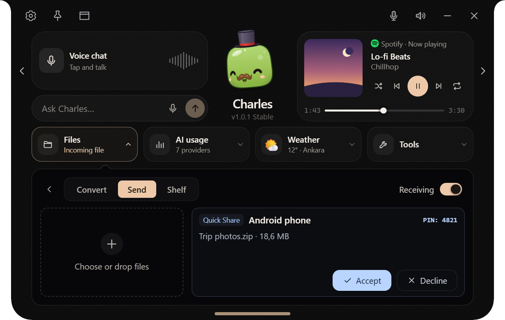
</p>

Received files go to Downloads; an existing file with the same name is preserved. Transfers have
been tested successfully on Samsung and other Android brands. Apple devices (iPhone, iPad and Mac)
use the **LocalSend app** to share files with Charles on the same local network. Native Apple
AirDrop/AWDL is not supported on Windows.

*Screenshots use sample file, device and status data.* [Sharing guide](docs/SHARING.md)

### Tools

The **Tools** card opens eight tools and your installed modules. Reminders, Calendar, Emails and
Smart home are the same cards as in the app window; Usage summary is the weekly summary from
Settings.

| Tool | What it does |
| --- | --- |
| **Color picker** | Pick a color anywhere on the screen with a magnifier (correct on HDR screens too), adjust it, copy it as HEX · RGB · HSL; four shades and your recent colors |
| **Timer** | Focus sessions with a task name, a break you choose when the focus ends, countdown and stopwatch; it keeps running on the closed island and can mute notifications |
| **Reminders** | Upcoming reminders, tick them off, add a new one; Charles can also add them by voice |
| **Calendar** | The month with Google / Outlook events, reminders and holidays; the day’s list; Edit opens the full editor |
| **Emails** | Important emails (or the newest ones); a click lets Charles explain the email in the chat |
| **Usage summary** | This week or last week: time at the computer per day (active and idle), AI requests through Charles per day and per model, and your most used apps |
| **Smart home** | Your Home Assistant lights, plugs, sensors and scenes; switch them on the tile |
| **System monitor** | Live CPU, GPU and RAM charts with Current, Average and Peak values |

<p align="center">
  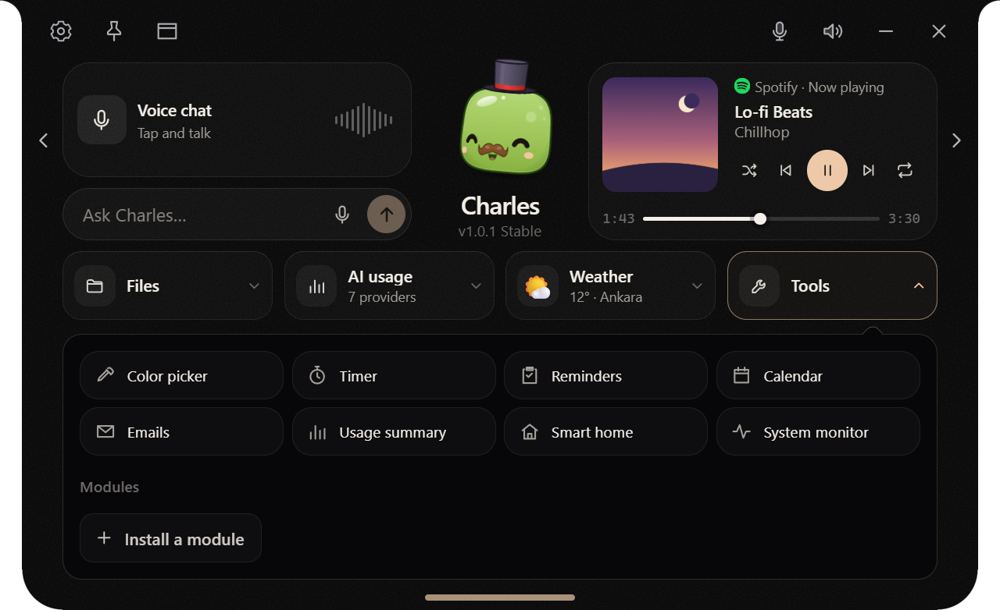
</p>

<p align="center">
  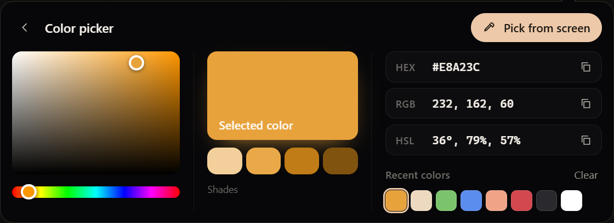
  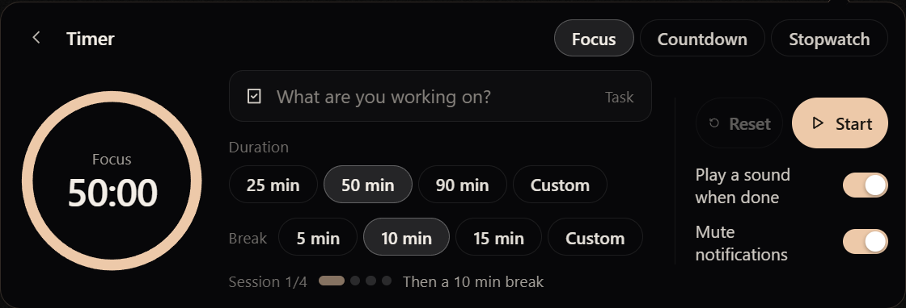
</p>
<p align="center">
  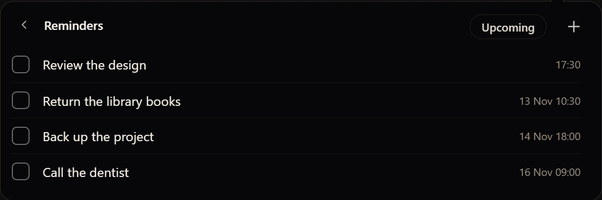
  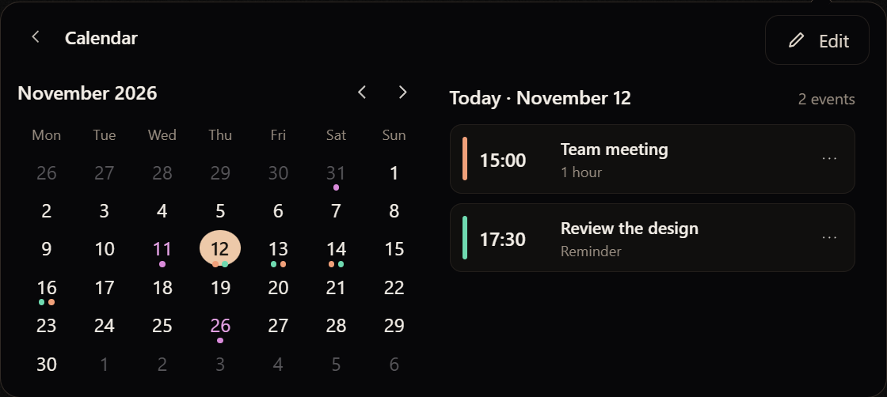
</p>
<p align="center">
  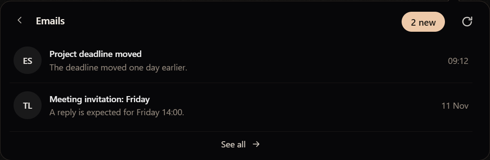
  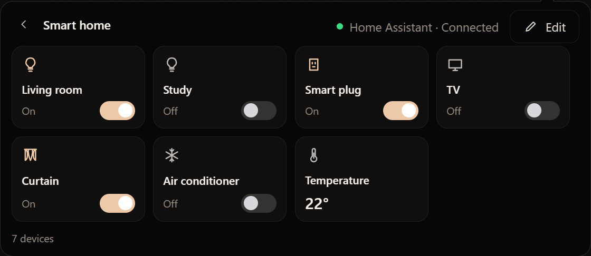
</p>

#### System monitor

Open **Tools → System monitor** to watch CPU, GPU and RAM side by side.

- **Current, Average, Peak:** pick what the big numbers show. The chart keeps running and marks the average or the peak.
- **1 min, 5 min, 1 hr:** the numbers and the chart always use the same range. A range that is not full yet says how long was really measured.
- **Pause and reset:** stop measuring for a moment, or clear the history.
- **Several GPUs:** a list lets you pick which one to follow.

Charles measures once a second while the monitor is on screen and every 5 seconds behind it, so
history is already there when you open it; **Measure in the background** turns that off. The last
hour stays in memory. Nothing is written to disk or sent anywhere, and time the computer slept
shows as a gap in the line.

Values come from Windows performance counters, so no driver or extra tool is needed. GPU load is
the busiest engine, as in Task Manager. GPU temperature and power appear when Windows reports them,
and power is a percentage rather than watts. CPU temperature has no reliable source and shows
**No data**. Tested on one NVIDIA GPU; several GPUs and other vendors have not been tested.

<p align="center">
  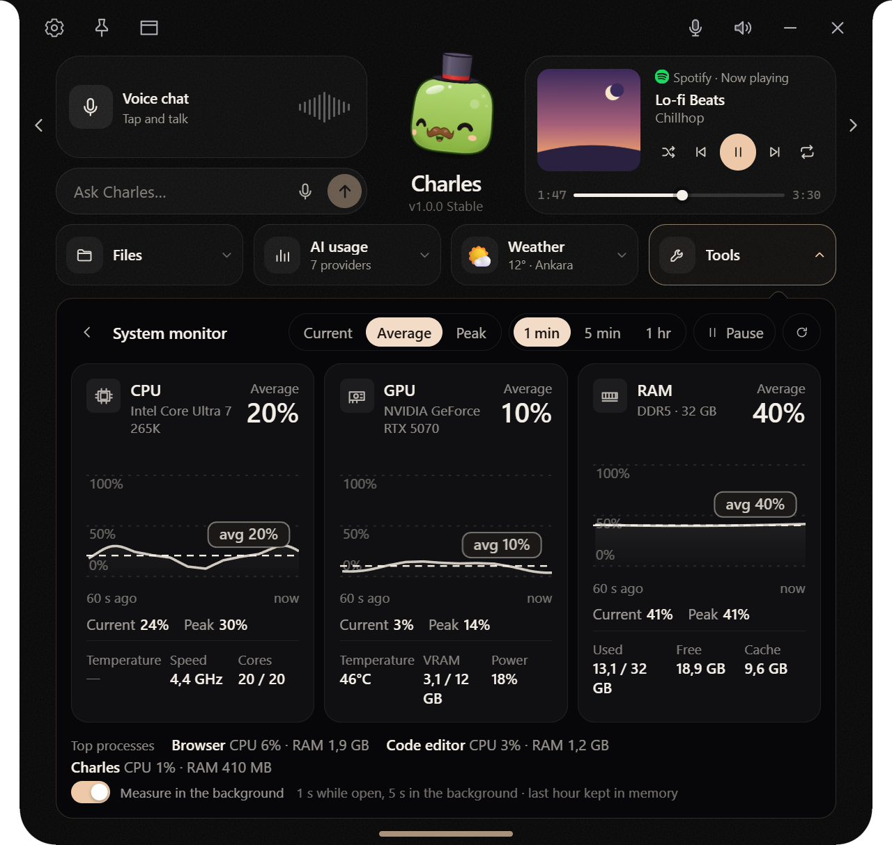
</p>

### AI usage, weather and the usage summary

Three views that are easy to mix up, and what each one means:

| View | Where | What it shows |
| --- | --- | --- |
| **AI usage** | The island’s AI usage card, and the AI usage card on the app window’s home | What is left of each connected account’s allowance, as its provider reports it, with the windows it uses and when they reset. EVREN shows its tokens. A value that could not be read is marked as the last known one |
| **Usage summary** / **Weekly summary** | Tools → Usage summary, and Settings → Weekly summary (the same view) | What was measured on this computer this week or last week: time at the computer, AI requests made through Charles, and the apps in front. No quota and no cost |
| **Weather** | The island’s Weather card | The current conditions, the next hours, today and the next five days for the city you choose |

The usage summary and the weekly summary have one design: the date range in the title, the main
numbers large, daily charts with an axis and a legend, and AI requests also listed per model. A
value that was not measured is shown as “—”, never as 0; loading, no data, a week measured only in
part (it says from which day) and an error each have their own state. Time is counted only while
Charles is open, and sleep and lock time are left out. The summary reads its data only while it is
on screen, and can open by itself on Monday morning.

<p align="center">
  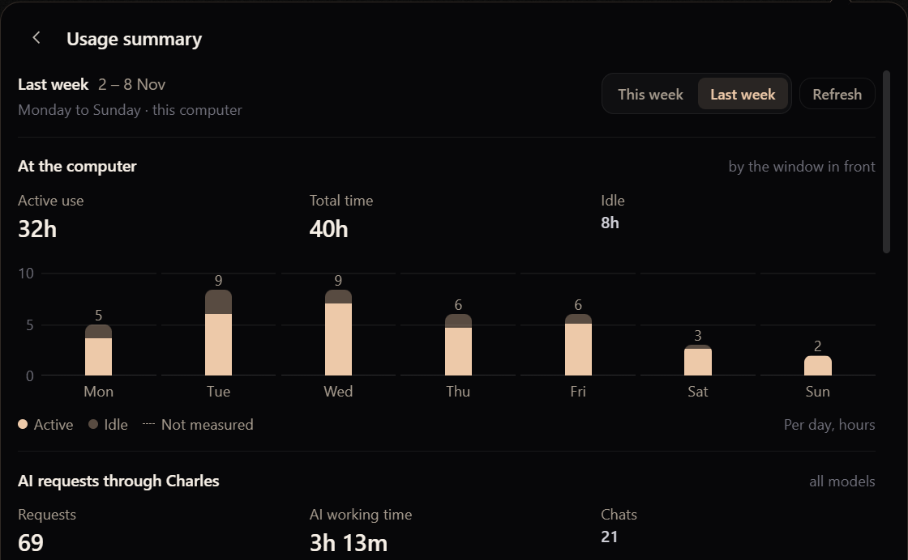
  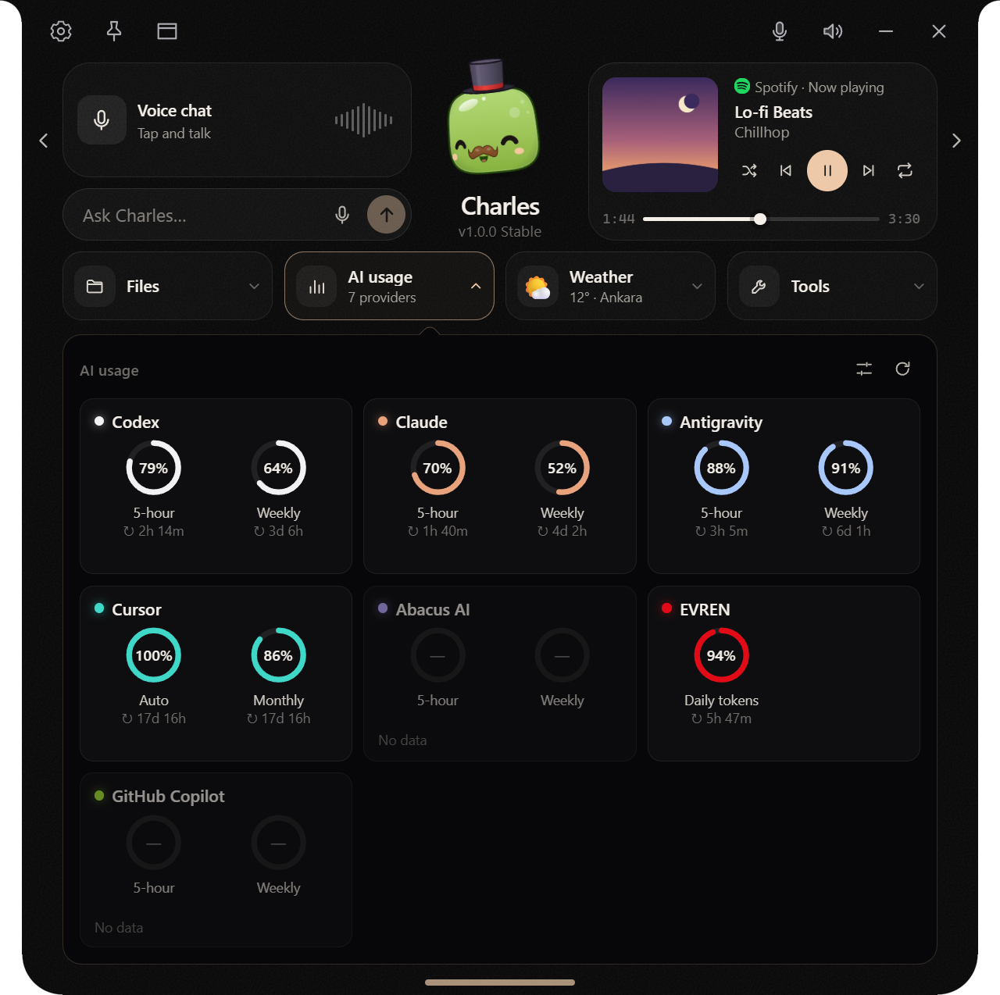
</p>
<p align="center">
  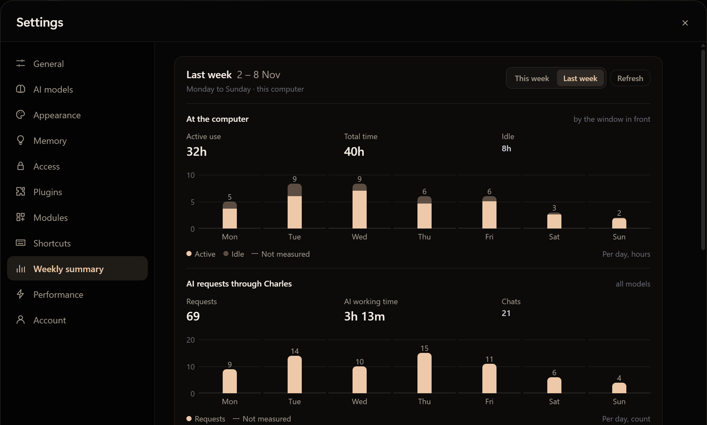
</p>
<p align="center">
  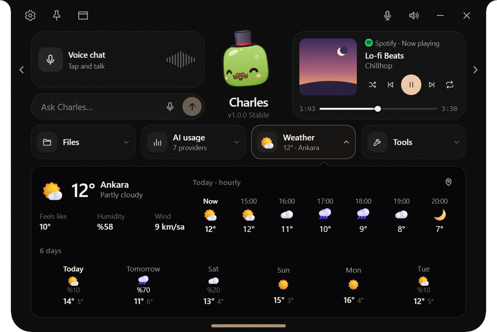
</p>

### Mail, calendar, WhatsApp and smart home

Connect these in **Settings → Plugins**; [PLUGINS-SETUP.md](docs/PLUGINS-SETUP.md) has the steps.

- **Mail:** Gmail, Outlook or any POP3/IMAP mailbox, read-only. Important mail appears as a card
  under the island and opens in its own chat, where Charles explains it. What counts as important
  is decided on your computer from flags and your keywords, or by the AI if you turn that on (it
  then gets the sender, the subject and a short preview).
- **Calendar:** Google and Outlook events in the month view; with Google Calendar connected, events
  you add are saved there. A date in an important mail can become an event after you say yes.
- **WhatsApp in Charles:** link WhatsApp once with a QR code. New messages appear under the island,
  with quick replies and a reply box; nothing is sent until you press send. The card in Settings
  shows the connection state in one place: off, waiting, the QR code, an error, or connected with
  the number. It uses an unofficial open-source bridge, so use it with your own account only.
- **Smart home:** Home Assistant lights, plugs, sensors and scenes, on a card and by voice or text.
- **Connected accounts** on the Plugins page show the same status line as the AI accounts (a green
  dot, **Connected** and the last check’s result); **Check connection** and the button that removes
  the connection appear while an account is connected, and the sign-in button while it is not.

<p align="center">
  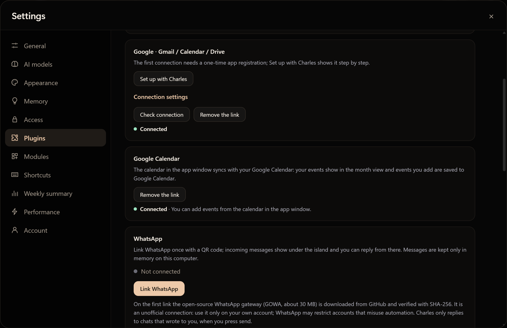
</p>

#### Notifications

Reminders, timers, updates, important mail, calendar events, WhatsApp messages, a running-out AI
allowance, a computer under heavy load, module notices, finished downloads and file sharing all use
one card design: a line icon, a title, the text, and a button that names what a click does (for
example **Let Charles explain**, **See what’s new** or **Show in folder**). The WhatsApp card shows
the WhatsApp mark. Cards are in all six interface languages, with numbers written the way the
language writes them.

The cards appear under the island, beside a tall panel, or in the corner of the app window, without
taking the keyboard from what you are typing. They wait while a full-screen program covers the
display they would appear on, and come up when you leave it.

### Slime

- More than 20 expressions and work animations: in love, dizzy, sleeping, researching with a
  magnifier, coding, drawing, getting an idea and more.
- **Slime studio:** seven colours, a moustache, and hats, glasses and other accessories to mix
  and match. Seasonal hats come on their own.
- **Desktop pet:** drag Slime onto your desktop, throw him and watch him bounce like jelly. From
  the app window or the open island he leaves his place empty and everything else stays where it
  is; double-click him to send him home. After reading a page or document he goes back by himself.
- He dances while music plays, yawns and falls asleep when nothing happens, and wakes up when you
  come back.

<p align="center">
  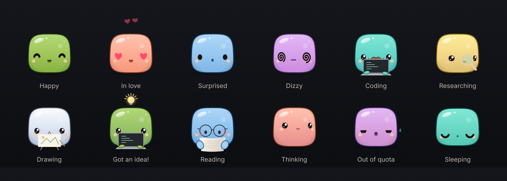
</p>

### Settings

| Page | What you will find |
| --- | --- |
| **General** | Language, start with Windows, sounds, auto-hide and collapse, read aloud, Hey Charles, weather location, updates, welcome tour |
| **AI models** | The default model list, the account cards (each with one status line while connected), Gemini Live with its voice and key settings |
| **Appearance** | Text, panel, character and island size, the screen to use, Slime studio |
| **Memory** | Things Charles should remember; “Get to know me from the AI I use” |
| **Access** | How much the AI may do without asking, in three short lines |
| **Plugins** | Notifications and keywords, Google, Microsoft, Home Assistant, POP3/IMAP mail, Google Calendar, WhatsApp and its contacts |
| **Modules** | Install, permissions, remove |
| **Shortcuts** | Every global shortcut, and push to talk |
| **Weekly summary** | This week or last week, as described above |
| **Performance** | Optional CPU, RAM and GPU history kept on this computer; **Low memory mode**, which turns graphics acceleration off so Charles uses less memory and a little more processor time during animations (off unless you turn it on; it takes effect when Charles restarts) |
| **Account** | Which accounts are connected, **Open data folder**, **Remove account connections**, **Reset all data** (both ask first) |

### Keyboard shortcuts

These work from any app and can be changed in **Settings → Shortcuts**.

| Shortcut | Action |
| --- | --- |
| Ctrl + Alt + C | Open the chat |
| Ctrl + Alt + A | Jump to the latest alert |
| Ctrl + Alt + T | Show the latest terminal activity |
| Ctrl + Alt + → / ← | Next / previous chat |
| Ctrl + Alt + V | Start or end a voice conversation |
| Ctrl + Alt + D | Dictate |
| Ctrl + Alt + M | Move Slime to the desktop |
| Ctrl + Alt + W | Open the Slime studio |
| Ctrl + Shift + S | Capture a screen region |
| Right Arrow + Up Arrow (hold) | Push to talk, when it is turned on |

## Modules

<p align="center">
  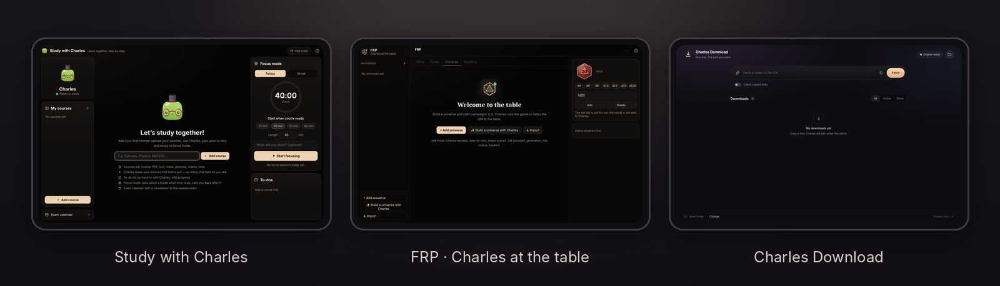
</p>

Modules add whole new tools to Charles, each in its own window: **Study with Charles** (courses,
sources, a tutor that reads them, focus timer, exam countdown), **FRP** (Charles runs your
tabletop game or helps the GM) and **Charles Download** (videos, audio or just the part you
want). Install them from a `.zip` in **Settings → Modules**; the open ones are one click away on
the **Modules** card of the app window’s home.

**Get the official modules:** [**Releases → Modules**](https://github.com/ardadgnyt/ProjectCharles/releases#release-Modules)

**Build your own:** anyone can make a module. A module is a small web page with a
`manifest.json`; through Charles it can ask the user’s AI (with pictures), create images, speak,
keep its own files, show notifications, use Charles’ download engine, and draw Slime with his
accessories, reactions and cursor tracking — every ability behind a permission the user
approves. See [docs/MODULES.md](docs/MODULES.md).

## Your data and privacy

- Chats, memory, settings and **all keys and account connections** live in
  **`%APPDATA%\Charles`**, never in the app folder; keys are encrypted with Windows (DPAPI).
- Updates and new installs keep your data. **Settings → Account** opens this folder and can
  remove connections or reset everything (it asks first and keeps a backup).
- Mail, calendar and Drive connections are **read-only**; incoming content never runs
  commands.
- **WhatsApp** messages stay in memory only. The open-source gateway is downloaded only when you
  turn the feature on, checked against its SHA-256 and runs on this computer only.
- The microphone button turns off Hey Charles, dictation, push to talk and voice chat. Your
  messages go only to the AI provider you choose.
- Notification cards and the island do not come up over a full-screen program on their display.
- **Push to talk** uses local speech recognition. **System monitor** readings stay in memory.
  **Dropping Charles on content** reads it only at that moment, never in the background, and it
  leaves your computer only when you send a question.

Safety rules that hold in every chat:

- A message that carries outside content (a mail Charles opened or found, or what he read when you
  dropped him on a page, a document or a mail) runs without tools and with web search turned off,
  and the chat says so. Text from outside, and the text of files you attach, is fenced as data:
  invisible characters in it are removed and tags that pretend to end that data or to speak for the
  system are made harmless.
- **“Remember this”** saves one line of at most 300 characters; for a longer pasted text Charles asks
  which sentence to remember instead of storing it.
- A converted file never replaces an existing one; a second job on the same file takes the next free
  name.
- An archive with a path that leaves its folder, a link, a device file or an entry the check cannot
  read is not opened.
- A program or script file that an AI wrote is shown in its folder instead of being started when you
  choose to open it.

## Running from source

The repository holds the source code and the download tools for Charles Download
(`tools/download/`: yt-dlp and FFmpeg, see `licenses/download/`); `node_modules/`, `dist/`, the
speech models and the other helper tools are created or downloaded on your machine. You need
[Node.js](https://nodejs.org) 22 or newer.

```cmd
git clone https://github.com/HzPederPan/ProjectCharles.git
cd ProjectCharles
npm ci
npm run setup
npm run build
npm start
```

| Command | Purpose |
| --- | --- |
| `npm run setup:voice` | Optional: whisper.cpp and the speech model (~500 MB) |
| `npm test` | Automated tests |
| `npm run dev` | Build the interface and start Electron |
| `python scripts/setup-pack.py <folder>` | `CharlesSetup.exe` + `.sha256` |
| `npm run release:pack` | `charles-update-<version>.zip` + `.sha256` for in-place updates |

The Antigravity and Cursor sign-in helpers come with the release package. Abacus AI
uses its own `abacusai` command line tool
([setup page](https://abacus.ai/help/abacusai-desktop/cli-installation)).

## Project layout

```text
ProjectCharles/
├── Start-Charles.cmd     start Charles from this folder
├── setup/                installer, shortcut, reset
├── app/                  Electron main process: AI, plugins, modules, voice
├── src/                  interface (TypeScript) → dist/renderer.js
│   ├── vendor/slime/     the Slime character
│   └── module-kit/       Slime for module windows
├── public/               HTML, CSS, sounds, icons
├── scripts/              build, packaging, voice setup
├── test/                 automated tests
└── docs/                 guides and README images
```

## Documentation

| Document | Contents |
| --- | --- |
| [CHANGELOG.md](CHANGELOG.md) | What changed in every version (English from v0.9.18; older entries are in Turkish) |
| [DEVELOPMENT.md](DEVELOPMENT.md) | Code tour, data files, build and test |
| [docs/USER-GUIDE.md](docs/USER-GUIDE.md) | Chat, project mode, voice, Slime, settings, shortcuts |
| [docs/SHARING.md](docs/SHARING.md) | Quick Share and LocalSend |
| [docs/PLUGINS-SETUP.md](docs/PLUGINS-SETUP.md) | Google, Microsoft, mail, Home Assistant, WhatsApp, notifications, AI account cards |
| [docs/ARCHITECTURE.md](docs/ARCHITECTURE.md) | How the parts fit together |
| [docs/MODULES.md](docs/MODULES.md) | Writing modules: package, permissions, API, Slime kit |
| [docs/UPDATES.md](docs/UPDATES.md) | In-place updates from GitHub Releases |

## Credits

- Charles’s design is inspired by **Charles** from the *Epic Minequest* series on
  [Sam Green’s YouTube channel](https://www.youtube.com/@SamGreen). Project Charles is a
  fan-inspired, independent project, not affiliated with or endorsed by Sam Green.

## License

Copyright © 2026 **HzPederPan**.

The source code is licensed under **GNU GPL v3 or later**. You may use, modify
and redistribute it under that license, including commercially. The in-place
update package (`charles-update-<version>.zip`) includes the Charles source
(`app/`, `src/`), tests and build scripts; the installer (`CharlesSetup.exe`)
carries `app/` and the built interface without `src/`, `test/` and `scripts/`.
The complete source of every published version is in this public repository,
<https://github.com/ardadgnyt/ProjectCharles>, under the release of the same
version. Third-party
components retain their notices. Artwork and names are described separately in
[LICENSE-ASSETS.md](LICENSE-ASSETS.md). See also [LICENSE](LICENSE) and
[THIRD-PARTY-NOTICES.md](THIRD-PARTY-NOTICES.md).

Charles is an independent project. It is not affiliated with OpenAI, Anthropic, Google,
Cursor, Abacus AI or WhatsApp.
